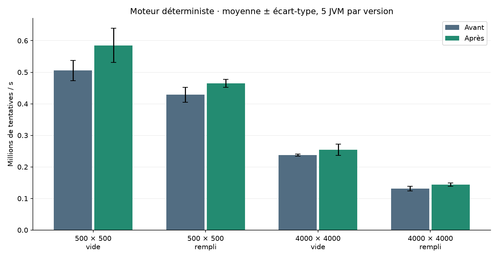
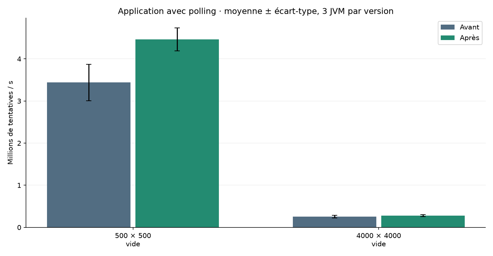
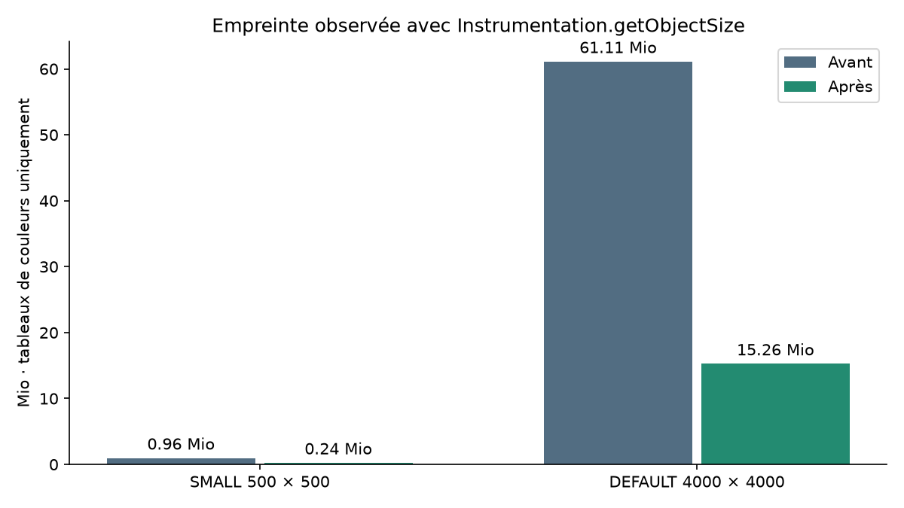
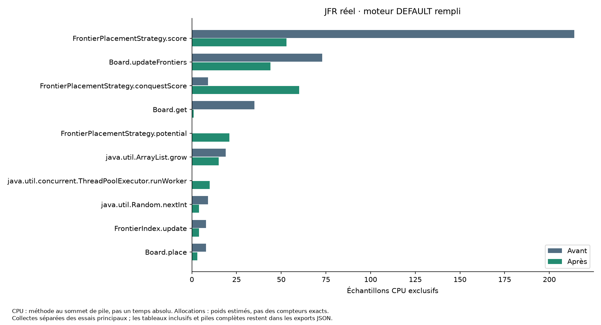
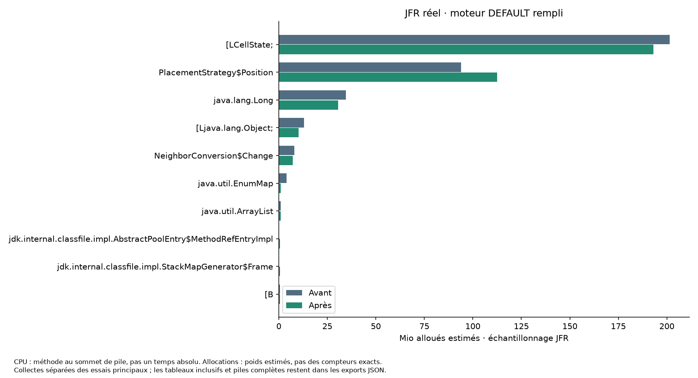
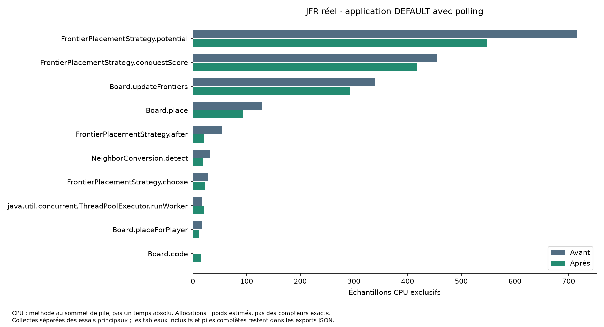
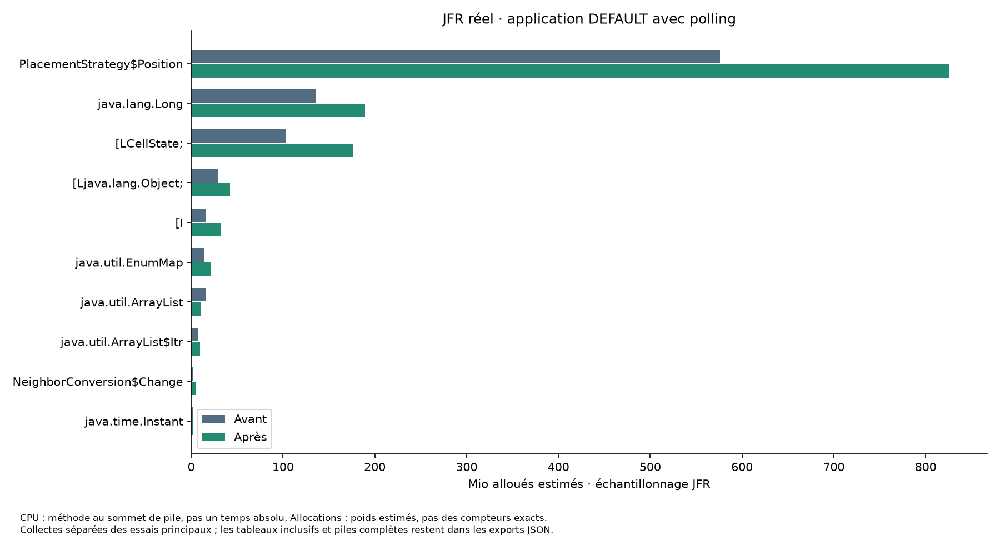

# Optimisation 01 — stockage compact du plateau

## Synthèse autonome

Pixel War simule quatre joueurs sur un plateau partagé. Le plateau DEFAULT de 4 000 × 4 000 contient 64 fois plus de cellules que SMALL de 500 × 500. Le besoin est d’étudier un gain de capacité du moteur sans modifier la partie simulée, tout en produisant des preuves réutilisables dans un audit final.

Cette étape remplace uniquement les couleurs de `CellState[][]` par un tableau linéaire `byte[]`, avec codes stables 0 à 4 et décodage constant. Les stratégies, tirages aléatoires, frontières, index de cases vides, compteurs, conversions, verrous, métriques affichées et paramètres de gameplay restent conservés.

Référence avant : **`01fdacf4ea0abe6673767f51f51fd37ca425ad5d`** ; référence après : **`d1b48a69132684a7d611847078402fb8e277346d`**. La branche de départ utilisateur est `refacto_metriques`, commit `edd05c5586beb3b48b6bc21d9283a5df2e76f074`. Le commit de préparation `5870112` copie les six fichiers de métriques non suivis nécessaires à une compilation complète ; il ne change pas leur contenu. La nouvelle branche `opti/01-board-compact` est dans un worktree isolé. La branche et les changements locaux de référence ont été conservés.

En comparaison des moyennes, les variations de tentatives/s moteur sont : **SMALL vide 15,73 %**, **SMALL rempli 8,44 %**, **DEFAULT vide 6,97 %**, **DEFAULT rempli 9,57 %**. Sous scheduler et polling, elles sont **SMALL 29,64 %** et **DEFAULT 7,62 %**. Les dispersions et les rapports appariés sont présentés plus bas ; ces chiffres ne sont pas un gain unique agrégé.

La mesure par Instrumentation isole une baisse d’environ 75 % de la mémoire des tableaux de couleurs. Elle ne concerne ni les frontières ni les autres index. Les 70 tests après changement passent, contre 68 avant. **Les 32 comparaisons d’états finaux vérifient les mêmes empreintes SHA-256 spatiales et les mêmes compteurs et états métier.**

Une **action** est une exécution réelle pour un joueur non éliminé ; une **tentative** est un choix de coordonnée et une pose essayée ; une **modification directe** est une pose qui change une couleur ; une **conversion** est un changement décidé par les quatre voisins, détecté sur un état stable puis appliqué avec les autres décisions de la passe. Les appels ignorés pour les joueurs éliminés ne sont pas comptés comme actions.

Le pilote déterministe appelle l’action réelle séquentiellement, sans HTTP, avec un budget identique d’actions. Il ne mesure pas le scheduler ou le réseau. L’essai applicatif utilise le scheduler réel et des lectures HTTP concurrentes ; il mesure une fenêtre active, pas le temps d’un budget fixe. Aucun temps de victoire n’est déduit des débits.

## 1. Références, environnement et isolation

| Élément | Valeur observée |
|---|---|
| OS | Microsoft Windows 11 Famille, 10.0.26300, 64 bits |
| JVM | OpenJDK 27, build 27+35-2325 ; compilation ciblant Java 21 |
| CPU | Intel Core i5-13600KF, 14 cœurs physiques, 20 processeurs logiques |
| RAM visible | 34 188 517 376 octets |
| Caches rapportés par CIM | L2 : 20 480 Kio ; L3 : 24 576 Kio ; topologie détaillée et L1 non mesurées |
| Flags des JVM expérimentales | `-Xms2g -Xmx2g -XX:+UseG1GC`, même agent de mesure de taille |
| Collecteur | G1 ; heap de 2 Gio identique avant/après |
| Stock et gameplay | Stock désactivé, frontier, exploration 0,10, 10 candidats, bonus 8, priorité 20 actions, 10 tentatives/action, conversions activées |
| Cadence et aperçu | 10 ns demandées ; aperçu 500 × 500, inchangé dans les deux versions |
| Graines | 11 pour les performances ; 11, 22 et 33 pour les rejeux |
| État rempli | Couleur tirée par `Random(seed + 1000)` pour chaque cellule, via `Board.place` |

Les processus sont séquentiels, sans benchmark concurrent de cette campagne. Aucune affinité CPU, fréquence fixe, désactivation du turbo ou isolation matérielle n’a été imposée. Le système peut avoir une activité de fond ; la topologie P/E et les migrations de cœur ne sont pas contrôlées. Les répétitions et leur dispersion rendent ce bruit visible, sans prétendre le supprimer. Aucun compteur matériel de cache-misses n’a été mesuré.

Pièces : [environnement](01-board-compact/environment.json), [version JVM](01-board-compact/java-version.txt), [invocations](01-board-compact/invocations.jsonl), [référence du binaire avant](01-board-compact/build-before.json), [après](01-board-compact/build-after.json), [provenance des fichiers locaux](01-board-compact/provenance/local-files-before.json). Les SHA-256 des binaires sont aussi répétés dans les essais bruts. Les archives de sources étaient propres aux références mesurées ; les changements d’outillage d’analyse ultérieurs sont livrés séparément et n’affectent pas les deux binaires mesurés.

## 2. Diagnostic initial et hypothèse

Le stockage initial comporte un tableau de lignes puis une référence enum par cellule. Le [diagnostic écrit avant changement](01-diagnostic-initial.md) décrit les accesseurs, le marquage des mutations et les calibrations. Le profil moteur DEFAULT rempli avant changement observe 214 échantillons CPU exclusifs au sommet de `FrontierPlacementStrategy.score`, 73 dans `Board.updateFrontiers`, 35 dans `Board.get` et 19 dans `ArrayList.grow`. Ces échantillons ne prouvent pas des défauts de cache.

Les allocations échantillonnées avant contiennent notamment des tableaux d’enums issus des appels de stratégie, des objets de position et des `Long`. Ce ne sont pas les tableaux persistants de couleurs construits avant la fenêtre de profiling. Les autres candidats d’optimisation restent hors périmètre.

Hypothèse : réduire les références et les indirections peut aider les accès, mais la multiplication d’index et le décodage peuvent coûter du CPU. Le coût des stratégies et des structures dérivées peut rester dominant. L’intérêt mémoire doit donc être évalué séparément du débit.

## 3. Changement isolé

`Board.cells` devient un `byte[]`. L’index est `y * width + x`, après contrôle indépendant de x et y. Une table statique de cinq enums décode les lectures sans allocation par accès ; un `switch` encode les écritures. La table statique, partagée, n’est pas incluse dans la mesure des seuls tableaux par plateau.

Le produit des dimensions est vérifié en `long` avant toute allocation, puis borné à l’indexation `int`. Les dimensions non positives restent rejetées par `IllegalArgumentException`, et les produits trop grands par `ArithmeticException`. Une taille compatible avec `int` peut encore dépasser la limite effective des tableaux JVM ou la heap disponible : aucune allocation géante n’est promise.

Les voisins utilisent les offsets du tableau linéaire après contrôle des bords. Les lectures publiques renvoient toujours `CellState` ; les codes ne sont pas exposés en HTTP. `place`, `placeIfEmpty`, `placeForPlayer`, le reset et l’aperçu conservent leurs notifications et leur synchronisation. Les accès restent O(1), la conversion et le scoring gardent leurs algorithmes.

Le diff entre les deux références ne touche que `Board.java` et `CompactBoardTests.java` : [patch](01-board-compact/patches/storage.patch). Aucun pooling, snapshot, parallélisme, changement de cadence, bonus, taille d’aperçu ou seconde optimisation n’est ajouté. Les scripts et le rapport d’audit sont des livrables d’expérience distincts.

## 4. Protocole de mesure

### Moteur déterministe

Chaque observation est une JVM neuve. Elle chauffe pendant trois secondes sur un plateau dédié, détruit cette simulation, puis recrée le même état initial et réinitialise les générateurs. Une GC explicite est demandée hors mesure après préparation, identiquement dans les deux versions. Le chronométrage exclut construction, préparation, GC demandée, comparaison des états et calcul de l’empreinte.

Le pilote lit le compteur privé d’actions en réflexion pour compter seulement les exécutions réelles. Il conserve la rotation explicite du premier joueur et s’arrête au budget exact, même après des éliminations. Il ajoute donc un léger coût de pilotage commun ; ce n’est pas un microbenchmark isolé de `Board.get`.

Budgets calibrés sur 5 000 actions de la baseline pour viser environ deux secondes, puis figés : SMALL vide **127000**, SMALL rempli **78000**, DEFAULT vide **65000**, DEFAULT rempli **18000**. L’évolution de l’état pendant une charge plus longue peut faire varier sa durée par rapport à la calibration. Cinq paires sont exécutées par scénario pour la graine 11, dans l’ordre A/B, B/A, A/B, B/A, A/B.

Le temps CPU et les allocations exactes par thread sont des deltas du thread pilote qui exécute le moteur. La heap est celle de toute la JVM, échantillonnée par un thread daemon toutes les 10 ms, avec observation initiale et finale. Un pic court peut être manqué ; ce n’est ni une heap retenue après GC ni la mémoire totale du processus. Les compteurs GC/JFR ne sont pas extrapolés depuis les allocations par action.

### Application avec polling

Trois paires de JVM neuves par taille, départ vide. Le pilote démarre les vrais contrôleurs, filtre, moteur et scheduler à travers une configuration Spring réservée au banc ; il ne modifie pas l’API de production. Le code de la simulation et les assets sont ceux du binaire concerné.

Après cinq secondes de chauffe, une pause permet une borne cohérente, puis la simulation reprend pendant une fenêtre d’au moins vingt secondes. Le client externe lance simultanément les quatre lectures `/api/simulation`, `/api/simulation/scores`, `/api/performance`, `/api/board/preview`, à une période cible de 1 000 ms, sans modifier l’aperçu. Chaque requête conserve route, durée, statut et erreur. La pause finale et les éventuels retards du dernier groupe peuvent légèrement allonger la fenêtre ; sa durée réelle est enregistrée et sert aux débits.

P95 et P99 HTTP sont calculés au rang supérieur sur les requêtes réussies individuelles côté client, transfert compris, contrairement aux percentiles serveur affichés dans l’application. Ils ne sont pas la dispersion des moyennes entre essais. Le CPU moteur, le CPU processus et les allocations moteur sont mesurés par deltas aux bornes. Les fenêtres applicatives n’exécutent pas une charge identique : un moteur plus rapide peut avoir avancé davantage pendant la chauffe et la mesure. Les états de départ/fin et les éliminations sont conservés dans les données brutes.

Le départ rempli applicatif est **non mesuré** : il est traité par les essais moteur et les profils moteur complémentaires, conformément à l’option de réduction de matrice du document. La chauffe applicative est fixe ; la stabilité de compilation/fréquence n’est pas démontrée par un test statistique indépendant. Cela limite l’attribution des petites variations.

### Profils séparés

JFR est désactivé dans les observations principales. Deux profils par version sont capturés à part : moteur DEFAULT rempli, graine 11, 72000 actions ; application DEFAULT vide avec polling et même fenêtre de vingt secondes. Configuration JFR `profile`, `jdk.JavaMonitorEnter` avec seuil 1 ms et piles, `jdk.ObjectAllocationSample` avec piles. Les durées et débits des essais profilés ne sont pas mélangés aux répétitions principales.

## 5. Validation fonctionnelle

Les tests avant et après sont conservés : [68 tests avant](01-board-compact/logs/build-before.log), [70 tests après](01-board-compact/logs/build-after.log). Les nouveaux cas couvrent cinq états, coins, rectangles, rejet du passage artificiel d’une ligne à l’autre, produit de dimensions, reset, conquête, pose sans changement, scores et aperçu comparés à un modèle 2D indépendant. Les tests antérieurs vérifient frontières, conversions simultanées et différées, stock conditionnel, éliminations, priorité, pause, stop, API et absence de mutations tardives.

Le rejeu supplémentaire couvre les deux tailles, les deux états initiaux et les graines 11, 22, 33 sur 10 000 actions. Il compare SHA-256 de toutes les cellules dans l’ordre des coordonnées, comptes de couleurs, tailles de frontières, actions, tentatives, modifications, conversions, actions sans stock, consommation/recharge, éliminations et cibles prioritaires. Les vingt paires de charges moteur principales sont également comparées. Les durées, heap et métriques JVM sont exclues de l’égalité : [32 comparaisons réussies](01-board-compact/replay-verification.json).

## 6. Résultats individuels et statistiques

Convention : moyenne arithmétique, médiane, écart-type et **variance d’échantillon** (diviseur n−1). Les unités au carré de la variance correspondent à celles indiquées dans les tableaux. Toutes les observations individuelles sont conservées avec davantage de précision que l’affichage. Les effets sont calculés séparément par scénario et graine, jamais en agrégeant SMALL avec DEFAULT.

Formules : accélération = temps avant / temps après ; variation débit = 100 × (débit après / débit avant − 1) ; réduction temps = 100 × (1 − temps après / temps avant) ; réduction mémoire = 100 × (1 − mémoire après / mémoire avant).

Pièces : [observations longues](01-board-compact/observations.csv), [statistiques complètes](01-board-compact/summary.csv), [rapports appariés individuels](01-board-compact/pairs.csv), [dispersion de ces rapports](01-board-compact/pair-summary.csv). Les lignes ci-dessous prennent les moyennes avant/après ; la dispersion des rapports n’est pas remplacée par le rapport de deux moyennes.

### Moteur — 500 × 500, vide
| Mesure | Avant | Après | Variation | Dispersion et n | Pièce |
|---|---:|---:|---:|---|---|
| Temps charge fixe | 2 521,02 ms | 2 185,98 ms | -13,29 % | σ 167,95 / 205,08 ms ; n=5/5 | [mesures](01-board-compact/summary.csv) |
| Tentatives/s | 505 475,99 /s | 585 010,21 /s | 15,73 % | σ 32 150,88 / 54 013,44 /s ; n=5/5 | [mesures](01-board-compact/summary.csv) |
| CPU moteur | 2 409,38 ms | 2 081,25 ms | -13,62 % | σ 155,62 / 220,25 ms ; n=5/5 | [mesures](01-board-compact/summary.csv) |
| Tableaux de couleurs | 0,96 Mio | 0,24 Mio | -75,25 % | σ 0,00 / 0,00 Mio ; n=5/5 | [mesures](01-board-compact/summary.csv) |
| Heap maximale échantillonnée | 470,05 Mio | 469,51 Mio | -0,11 % | σ 0,01 / 0,44 Mio ; n=5/5 | [mesures](01-board-compact/summary.csv) |
| Allocations/action | 3 826,00 o/action | 3 826,10 o/action | 0,00 % | σ 0,10 / 0,25 o/action ; n=5/5 | [mesures](01-board-compact/summary.csv) |
| HTTP P95 | non mesuré | non mesuré | non mesuré | hors de cet essai | [protocole](01-board-compact/environment.json) |

| Mesure | Version | Moyenne | Médiane | Écart-type | Variance d’échantillon | n |
|---|---|---:|---:|---:|---:|---:|
| Temps charge (ms) | before | 2 521,02 | 2 446,58 | 167,95 | 28 206,90 ms² | 5 |
| Temps charge (ms) | after | 2 185,98 | 2 150,50 | 205,08 | 42 058,94 ms² | 5 |
| Débit (tentatives/s) | before | 505 475,99 | 519 091,66 | 32 150,88 | 1 033 678 784,65 tentatives/s² | 5 |
| Débit (tentatives/s) | after | 585 010,21 | 590 559,46 | 54 013,44 | 2 917 451 755,10 tentatives/s² | 5 |

Accélération calculée sur les durées moyennes : **1,153×** ; réduction du temps : **13,29 %**.

### Moteur — 500 × 500, rempli
| Mesure | Avant | Après | Variation | Dispersion et n | Pièce |
|---|---:|---:|---:|---|---|
| Temps charge fixe | 1 824,25 ms | 1 679,10 ms | -7,96 % | σ 102,08 / 46,87 ms ; n=5/5 | [mesures](01-board-compact/summary.csv) |
| Tentatives/s | 428 628,57 /s | 464 819,48 /s | 8,44 % | σ 23 633,64 / 12 802,19 /s ; n=5/5 | [mesures](01-board-compact/summary.csv) |
| CPU moteur | 1 746,88 ms | 1 587,50 ms | -9,12 % | σ 123,72 / 20,96 ms ; n=5/5 | [mesures](01-board-compact/summary.csv) |
| Tableaux de couleurs | 0,96 Mio | 0,24 Mio | -75,25 % | σ 0,00 / 0,00 Mio ; n=5/5 | [mesures](01-board-compact/summary.csv) |
| Heap maximale échantillonnée | 381,86 Mio | 381,12 Mio | -0,19 % | σ 0,01 / 0,01 Mio ; n=5/5 | [mesures](01-board-compact/summary.csv) |
| Allocations/action | 4 917,21 o/action | 4 917,21 o/action | -0,00 % | σ 0,00 / 0,00 o/action ; n=5/5 | [mesures](01-board-compact/summary.csv) |
| HTTP P95 | non mesuré | non mesuré | non mesuré | hors de cet essai | [protocole](01-board-compact/environment.json) |

| Mesure | Version | Moyenne | Médiane | Écart-type | Variance d’échantillon | n |
|---|---|---:|---:|---:|---:|---:|
| Temps charge (ms) | before | 1 824,25 | 1 807,70 | 102,08 | 10 421,10 ms² | 5 |
| Temps charge (ms) | after | 1 679,10 | 1 659,26 | 46,87 | 2 196,36 ms² | 5 |
| Débit (tentatives/s) | before | 428 628,57 | 431 486,83 | 23 633,64 | 558 549 071,04 tentatives/s² | 5 |
| Débit (tentatives/s) | after | 464 819,48 | 470 089,98 | 12 802,19 | 163 896 064,84 tentatives/s² | 5 |

Accélération calculée sur les durées moyennes : **1,086×** ; réduction du temps : **7,96 %**.

### Moteur — 4000 × 4000, vide
| Mesure | Avant | Après | Variation | Dispersion et n | Pièce |
|---|---:|---:|---:|---|---|
| Temps charge fixe | 2 734,17 ms | 2 565,80 ms | -6,16 % | σ 35,73 / 185,74 ms ; n=5/5 | [mesures](01-board-compact/summary.csv) |
| Tentatives/s | 237 764,18 /s | 254 337,92 /s | 6,97 % | σ 3 091,67 / 17 385,05 /s ; n=5/5 | [mesures](01-board-compact/summary.csv) |
| CPU moteur | 2 584,38 ms | 2 418,75 ms | -6,41 % | σ 40,75 / 162,15 ms ; n=5/5 | [mesures](01-board-compact/summary.csv) |
| Tableaux de couleurs | 61,11 Mio | 15,26 Mio | -75,03 % | σ 0,00 / 0,00 Mio ; n=5/5 | [mesures](01-board-compact/summary.csv) |
| Heap maximale échantillonnée | 532,58 Mio | 530,10 Mio | -0,47 % | σ 23,99 / 0,02 Mio ; n=5/5 | [mesures](01-board-compact/summary.csv) |
| Allocations/action | 6 080,91 o/action | 6 081,25 o/action | 0,01 % | σ 0,79 / 0,09 o/action ; n=5/5 | [mesures](01-board-compact/summary.csv) |
| HTTP P95 | non mesuré | non mesuré | non mesuré | hors de cet essai | [protocole](01-board-compact/environment.json) |

| Mesure | Version | Moyenne | Médiane | Écart-type | Variance d’échantillon | n |
|---|---|---:|---:|---:|---:|---:|
| Temps charge (ms) | before | 2 734,17 | 2 731,38 | 35,73 | 1 276,74 ms² | 5 |
| Temps charge (ms) | after | 2 565,80 | 2 462,66 | 185,74 | 34 497,91 ms² | 5 |
| Débit (tentatives/s) | before | 237 764,18 | 237 975,13 | 3 091,67 | 9 558 393,06 tentatives/s² | 5 |
| Débit (tentatives/s) | after | 254 337,92 | 263 942,73 | 17 385,05 | 302 239 840,00 tentatives/s² | 5 |

Accélération calculée sur les durées moyennes : **1,066×** ; réduction du temps : **6,16 %**.

### Moteur — 4000 × 4000, rempli
| Mesure | Avant | Après | Variation | Dispersion et n | Pièce |
|---|---:|---:|---:|---|---|
| Temps charge fixe | 1 375,22 ms | 1 252,85 ms | -8,90 % | σ 84,31 / 46,57 ms ; n=5/5 | [mesures](01-board-compact/summary.csv) |
| Tentatives/s | 131 269,55 /s | 143 829,68 /s | 9,57 % | σ 7 772,44 / 5 277,18 /s ; n=5/5 | [mesures](01-board-compact/summary.csv) |
| CPU moteur | 1 300,00 ms | 1 190,62 ms | -8,41 % | σ 60,92 / 51,11 ms ; n=5/5 | [mesures](01-board-compact/summary.csv) |
| Tableaux de couleurs | 61,11 Mio | 15,26 Mio | -75,03 % | σ 0,00 / 0,00 Mio ; n=5/5 | [mesures](01-board-compact/summary.csv) |
| Heap maximale échantillonnée | 733,95 Mio | 689,60 Mio | -6,04 % | σ 2,06 / 1,13 Mio ; n=5/5 | [mesures](01-board-compact/summary.csv) |
| Allocations/action | 5 863,60 o/action | 5 863,33 o/action | -0,00 % | σ 1,05 / 1,06 o/action ; n=5/5 | [mesures](01-board-compact/summary.csv) |
| HTTP P95 | non mesuré | non mesuré | non mesuré | hors de cet essai | [protocole](01-board-compact/environment.json) |

| Mesure | Version | Moyenne | Médiane | Écart-type | Variance d’échantillon | n |
|---|---|---:|---:|---:|---:|---:|
| Temps charge (ms) | before | 1 375,22 | 1 343,45 | 84,31 | 7 108,72 ms² | 5 |
| Temps charge (ms) | after | 1 252,85 | 1 225,89 | 46,57 | 2 169,08 ms² | 5 |
| Débit (tentatives/s) | before | 131 269,55 | 133 983,50 | 7 772,44 | 60 410 867,20 tentatives/s² | 5 |
| Débit (tentatives/s) | after | 143 829,68 | 146 831,79 | 5 277,18 | 27 848 616,75 tentatives/s² | 5 |

Accélération calculée sur les durées moyennes : **1,098×** ; réduction du temps : **8,90 %**.

### Application avec polling — 500 × 500, vide
| Mesure | Avant | Après | Variation | Dispersion et n | Pièce |
|---|---:|---:|---:|---|---|
| Temps charge fixe | non mesuré | non mesuré | non applicable | fenêtre active ≥ 20 s, pas une charge fixe | [données](01-board-compact/summary.csv) |
| Tentatives/s | 3 440 194,17 /s | 4 459 791,48 /s | 29,64 % | σ 432 579,06 / 271 980,78 /s ; n=3/3 | [mesures](01-board-compact/summary.csv) |
| CPU moteur | 19 130,21 ms | 19 203,12 ms | 0,38 % | σ 91,55 / 649,71 ms ; n=3/3 | [mesures](01-board-compact/summary.csv) |
| Tableaux de couleurs | 0,96 Mio | 0,24 Mio | -75,25 % | σ 0,00 / 0,00 Mio ; n=3/3 | [mesures](01-board-compact/summary.csv) |
| Heap maximale échantillonnée | 1 227,94 Mio | 1 228,83 Mio | 0,07 % | σ 0,38 / 0,16 Mio ; n=3/3 | [mesures](01-board-compact/summary.csv) |
| Allocations/action | 737,22 o/action | 674,89 o/action | -8,45 % | σ 115,71 / 25,73 o/action ; n=3/3 | [mesures](01-board-compact/summary.csv) |
| HTTP P95 | 37,75 ms | 32,56 ms | -13,75 % | σ 8,19 / 3,31 ms ; n=3/3 | [mesures](01-board-compact/summary.csv) |

| Mesure | Version | Moyenne | Médiane | Écart-type | Variance d’échantillon | n |
|---|---|---:|---:|---:|---:|---:|
| Durée fenêtre (ms) | before | 20 018,79 | 20 020,82 | 5,73 | 32,83 ms² | 3 |
| Durée fenêtre (ms) | after | 20 348,12 | 20 024,08 | 573,75 | 329 192,59 ms² | 3 |
| Débit (tentatives/s) | before | 3 440 194,17 | 3 478 536,09 | 432 579,06 | 187 124 645 687,96 tentatives/s² | 3 |
| Débit (tentatives/s) | after | 4 459 791,48 | 4 505 219,51 | 271 980,78 | 73 973 546 364,49 tentatives/s² | 3 |

### Application avec polling — 4000 × 4000, vide
| Mesure | Avant | Après | Variation | Dispersion et n | Pièce |
|---|---:|---:|---:|---|---|
| Temps charge fixe | non mesuré | non mesuré | non applicable | fenêtre active ≥ 20 s, pas une charge fixe | [données](01-board-compact/summary.csv) |
| Tentatives/s | 257 081,29 /s | 276 682,01 /s | 7,62 % | σ 32 302,68 / 24 137,72 /s ; n=3/3 | [mesures](01-board-compact/summary.csv) |
| CPU moteur | 19 588,54 ms | 19 937,50 ms | 1,78 % | σ 253,07 / 717,22 ms ; n=3/3 | [mesures](01-board-compact/summary.csv) |
| Tableaux de couleurs | 61,11 Mio | 15,26 Mio | -75,03 % | σ 0,00 / 0,00 Mio ; n=3/3 | [mesures](01-board-compact/summary.csv) |
| Heap maximale échantillonnée | 1 289,48 Mio | 1 183,59 Mio | -8,21 % | σ 111,39 / 54,31 Mio ; n=3/3 | [mesures](01-board-compact/summary.csv) |
| Allocations/action | 2 301,76 o/action | 2 322,02 o/action | 0,88 % | σ 25,71 / 18,80 o/action ; n=3/3 | [mesures](01-board-compact/summary.csv) |
| HTTP P95 | 114,49 ms | 120,83 ms | 5,54 % | σ 71,53 / 28,18 ms ; n=3/3 | [mesures](01-board-compact/summary.csv) |

| Mesure | Version | Moyenne | Médiane | Écart-type | Variance d’échantillon | n |
|---|---|---:|---:|---:|---:|---:|
| Durée fenêtre (ms) | before | 20 019,65 | 20 025,75 | 13,19 | 174,05 ms² | 3 |
| Durée fenêtre (ms) | after | 20 432,51 | 20 191,36 | 570,73 | 325 735,72 ms² | 3 |
| Débit (tentatives/s) | before | 257 081,29 | 274 486,56 | 32 302,68 | 1 043 463 385,63 tentatives/s² | 3 |
| Débit (tentatives/s) | after | 276 682,01 | 274 836,62 | 24 137,72 | 582 629 360,65 tentatives/s² | 3 |

### Figures issues des données brutes







Les barres de débit représentent moyenne ± écart-type d’échantillon ; l’empreinte des couleurs est une taille de disposition mesurée, constante pour une taille/version donnée, pas une allocation/action ni une heap après GC.

## 7. Profils réels CPU, allocations et attentes

Les figures CPU comptent `jdk.ExecutionSample`, méthode au sommet de pile : portée **exclusive**. Elles ne sont pas un temps absolu, ni des compteurs de défauts de cache. Les exports contiennent aussi les méthodes inclusives, comptées au plus une fois par pile, et les piles complètes. Les événements natifs éventuels ne sont pas assimilés à ces échantillons Java.

Les figures allocations agrègent le champ `weight` de `jdk.ObjectAllocationSample` par classe. Ce sont des **octets estimés par échantillonnage**, pas les compteurs exacts d’allocations du thread ni la mémoire retenue. Les objets persistants préparés avant le profil, dont le board, n’y figurent pas comme coût de création du travail mesuré.









Ces vues annotées et exports jouent le rôle d’analyse de piles des profils pprof dans les supports, avec JFR plutôt que pprof. Cette substitution Java n’est pas présentée comme une approbation explicite de l’évaluateur. Une part relative peut augmenter sans augmentation du coût absolu ; comparer les budgets, durées et événements avant d’attribuer une cause.

| Profil | Version | Échantillons CPU Java | Échantillons allocations | GC observées | Durée cumulée des cycles GC | Pauses STW observées | Attentes `Simulation` ≥ 1 ms |
|---|---|---:|---:|---:|---:|---:|---:|
| moteur rempli | before | 421 | 704 | 0 | 0,00 ms | 0,00 ms | 0,00 ms |
| moteur rempli | after | 258 | 705 | 0 | 0,00 ms | 0,00 ms | 0,00 ms |
| application vide | before | 1957 | 2991 | 1 | 19,11 ms | 19,11 ms | 942,17 ms |
| application vide | after | 1565 | 4157 | 1 | 3,74 ms | 3,74 ms | 4 425,53 ms |

- **moteur rempli, before** : CPU exclusif `org.pixelwar.pixelwar.domain.FrontierPlacementStrategy.score` (214); `org.pixelwar.pixelwar.domain.Board.updateFrontiers` (73); `org.pixelwar.pixelwar.domain.Board.get` (35); `java.util.ArrayList.grow` (19); `java.util.Random.nextInt` (9). Allocations estimées : `[Lorg.pixelwar.pixelwar.domain.CellState;` (201,48 Mio); `org.pixelwar.pixelwar.domain.PlacementStrategy$Position` (93,99 Mio); `java.lang.Long` (34,50 Mio).
- **moteur rempli, after** : CPU exclusif `org.pixelwar.pixelwar.domain.FrontierPlacementStrategy.conquestScore` (60); `org.pixelwar.pixelwar.domain.FrontierPlacementStrategy.score` (53); `org.pixelwar.pixelwar.domain.Board.updateFrontiers` (44); `org.pixelwar.pixelwar.domain.FrontierPlacementStrategy.potential` (21); `java.util.ArrayList.grow` (15). Allocations estimées : `[Lorg.pixelwar.pixelwar.domain.CellState;` (192,98 Mio); `org.pixelwar.pixelwar.domain.PlacementStrategy$Position` (112,49 Mio); `java.lang.Long` (30,50 Mio).
- **application vide, before** : CPU exclusif `org.pixelwar.pixelwar.domain.FrontierPlacementStrategy.potential` (716); `org.pixelwar.pixelwar.domain.FrontierPlacementStrategy.conquestScore` (455); `org.pixelwar.pixelwar.domain.Board.updateFrontiers` (339); `org.pixelwar.pixelwar.domain.Board.place` (129); `org.pixelwar.pixelwar.domain.FrontierPlacementStrategy.after` (54). Allocations estimées : `org.pixelwar.pixelwar.domain.PlacementStrategy$Position` (576,33 Mio); `java.lang.Long` (135,24 Mio); `[Lorg.pixelwar.pixelwar.domain.CellState;` (103,46 Mio).
- **application vide, after** : CPU exclusif `org.pixelwar.pixelwar.domain.FrontierPlacementStrategy.potential` (547); `org.pixelwar.pixelwar.domain.FrontierPlacementStrategy.conquestScore` (418); `org.pixelwar.pixelwar.domain.Board.updateFrontiers` (292); `org.pixelwar.pixelwar.domain.Board.place` (93); `org.pixelwar.pixelwar.domain.FrontierPlacementStrategy.choose` (22). Allocations estimées : `org.pixelwar.pixelwar.domain.PlacementStrategy$Position` (826,09 Mio); `java.lang.Long` (189,36 Mio); `[Lorg.pixelwar.pixelwar.domain.CellState;` (176,46 Mio).

Les attentes cumulées de plusieurs threads peuvent dépasser une durée murale ; seuls les événements au-dessus du seuil sont observés. L’absence d’attente métier dans un essai mono-thread n’est pas une absence de contention du serveur. Une durée de cycle GC n’est pas une pause STW ; les deux colonnes proviennent de types d’événements distincts. On ne conclut pas à « zéro GC serveur » à partir d’un compteur métier d’allocations.

Profils réels, exports et données associées : [index des pièces](01-board-compact/INDEX.md). Les `.jfr` volumineux sont inclus dans le dossier de remise et l’archive, et peuvent rester hors Git ; les exports JSON et figures sont versionnés. Les données individuelles des essais profilés restent séparées des statistiques principales.

## 8. Analyse causale et décision

La baisse de taille des tableaux de couleurs est directement attribuable au passage des références 2D au tableau d’octets : elle est observée séparément par Instrumentation, avec en-têtes et alignements. L’agent n’instrumente pas les accès ; il mesure la disposition hors chronométrage. Les tailles des autres index ne sont pas créditées à cette optimisation.

Les variations de débit moteur sont compatibles avec un effet du changement de représentation, sur une charge dont l’état spatial final et les compteurs sont identiques. Elles ne démontrent pas des cache-misses supprimés : calcul d’index, décodage, inlining, compilation et localité peuvent tous contribuer. Les scénarios les plus dispersés ne permettent pas d’affirmer un gain stable de quelques pourcents. La [dispersion des rapports appariés](01-board-compact/pair-summary.csv) montre les paires favorables ou défavorables.

Le résultat applicatif ajoute scheduler, verrous, sérialisation, GC et polling. Il ne mesure pas le même nombre d’actions, et les trajectoires au début de sa fenêtre peuvent différer après une chauffe temporelle. Une variation applicative ne doit donc pas être attribuée uniquement au coût d’une lecture du board. La mémoire totale échantillonnée reste sensible au GC et aux allocations HTTP ; elle n’est pas la mesure isolée des couleurs.

**Décision : conserver le stockage compact pour sa réduction directement vérifiée de l’empreinte persistante et son équivalence fonctionnelle, en publiant séparément les résultats de débit et leurs régressions éventuelles.** Aucune modification supplémentaire n’est engagée pour améliorer artificiellement le résultat. Les allocations temporaires des stratégies (`values()`, positions, objets de conversion) et les attentes HTTP observées constituent des candidats à profiler plus finement lors d’une étape suivante, pas des optimisations réalisées ici.

Le résultat ne prédit ni un vainqueur ni le temps d’élimination : la géométrie, les 64 fois plus de cellules et la stratégie restent des contraintes de gameplay distinctes.

## 9. Reproduction, dictionnaire et remise

La reproduction du code nécessite le dépôt avec les deux références Git indiquées. Les [patchs](01-board-compact/patches/) rendent visibles la préparation de référence et le changement isolé ; l’archive ne contient pas de `.git` complet ni de secrets.

Prérequis : PowerShell Windows, JDK complet 27 identique pour les deux versions, Maven wrapper et accès aux dépendances, Python et les versions de `scripts/opti01/requirements.txt`. Matplotlib 3.11.2 et NumPy 2.5.4 ont produit les figures. L’environnement de campagne a installé ces paquets dans un dossier isolé sous `target` ; aucune modification du Python système n’est nécessaire.

Commande principale effectivement exécutée depuis le worktree :

```powershell
$env:PYTHONPATH='C:/Users/gui35/ideaProjects/pixel-war/target/opti-01/python-libs'
.\scripts\benchmark-opti-01.ps1 -BeforeRef 01fdacf -AfterRef d1b48a6 -Java 'C:/Users/gui35/.jdks/openjdk-27/bin/java.exe' -ResultsDir 'C:/Users/gui35/ideaProjects/pixel-war/target/opti-01/results' -Phase All -Resume
```

Avant cela, `-Phase Calibrate` a figé les budgets sur la référence et `-Phase Profiles` a conservé le diagnostic avant modification. Une exécution sans `-Resume`, dans un répertoire de résultats neuf, reconstruit les deux versions et reproduit toute la campagne en une commande. `-Resume` permet de reprendre uniquement les fichiers manquants et vérifie la référence des essais existants. L’analyse et les figures se reconstruisent aussi avec `python scripts/opti01/summarize.py <résultats>` ; le rapport est généré par `build_report.py`.

Le pilote PowerShell remplace le rôle d’orchestration des forks d’Hyperfine, mais les chronométrages Java excluent volontairement démarrage JVM et préparation. JFR remplace le rôle de profiling de pprof. JMH n’est pas utilisé car aucune opération isolée n’est présentée comme microbenchmark. L’adéquation de ces substitutions au barème reste à l’appréciation de l’évaluateur.

Les premières mises au point du banc ont corrigé des chemins absolus et le traitement de stderr sous Windows PowerShell, notamment les avertissements Mockito ; elles n’ont pas été présentées comme des régressions de stockage. Les références et commits de préparation en gardent la trace. Les durées effectives et erreurs de la campagne mesurée sont dans les essais individuels. Les essais principaux réussis ne sont pas remplacés silencieusement par SMALL.

Dictionnaire, unités et formules détaillés : [DICTIONNAIRE.md](01-board-compact/DICTIONNAIRE.md). Journaux de construction, tests, fichiers de provenance et commandes : [INDEX.md](01-board-compact/INDEX.md). L’archive `target/audit-opti-01.zip` contient rapport autonome, figures, relevés, profils réels, scripts, patchs et manifeste SHA-256. Les liens relatifs et empreintes sont vérifiés après extraction ; le résultat du contrôle est inclus.

## 10. Correspondance avec le barème

| Critère | Points | Statut et preuves de cette étape | Limites pour l’audit final |
|---|---:|---|---|
| Environnement et métrologie | 3 | **partiel** : sections 1 et 4, environnement, 5 paires moteur et 3 paires applicatives, statistiques complètes | Bruit OS, fréquence/affinité non fixées, L1/topologie fine et stabilité JIT non démontrées ; substitution à Hyperfine expliquée |
| Diagnostic matériel et profiling réel | 5 | **couvert pour cette étape** : sections 2 et 7, quatre JFR réels, exports CPU inclusifs/exclusifs, allocations et moniteurs, vues annotées | Aucun compteur de cache-misses ; validation de la substitution à pprof revient à l’évaluateur |
| Journal et démarche d’ingénierie | 5 | **couvert pour cette étape** : diagnostic préalable, changement isolé, patch, équivalence et résultats séparés mémoire/moteur/application | Cette étape ne couvre pas à elle seule concurrence, réseau ou persistance |
| Échec constructif | 3 | **partiel** : les rapports appariés rendent visibles d’éventuelles paires défavorables ; section 8 ne masque pas les régressions | Aucun échec d’architecture distinct n’est inventé ; une fluctuation isolée ne prouve pas une variante contre-productive |
| Reproductibilité et synthèse | 4 | **couvert pour cette étape** : script à deux références, données, 32 comparaisons d’état, figures, archive et manifeste | Nécessite dépôt/références et prérequis ; pas d’audit final de toutes les optimisations |
| Gouvernance technique IA | +2 | **non traité** : aucun `constitution.md` satisfaisant quatre directives n’a été trouvé dans ce dépôt | La présence du prompt ne suffit pas ; adaptation dédiée à prévoir |

Aucune note acquise n’est attribuée. Ce rapport est une étape mémoire/localité, pas un audit final ni une couverture intégrale des axes du cours. Les départs remplis applicatifs, les compteurs matériels et l’isolation thermique restent explicitement non mesurés ; les profils et figures annoncés sont fournis, sans capture reconstituée.

## Incident du banc et conservation des fichiers

Un port HTTP fixe a ?chou? au red?marrage du serveur. Le pilote conserve cet essai sous `raw/pilots/` et d?crit l?incident dans [socket-incident.txt](01-board-compact/socket-incident.txt). Les trois paires applicatives ont ?t? reprises int?gralement avec un port libre attribu? par le syst?me. Les six fichiers locaux de d?part ont ?t? contr?l?s par SHA-256 apr?s la campagne : tous sont inchang?s.
