# Optimisation 02 — étude du coût des compteurs

## Décision et résultat

**Piste non applicable dans cette architecture : aucun compteur atomique redondant n'existe en production.** Les compteurs techniques sont déjà des `long` ou `long[]` sous le moniteur Simulation, ceux du Board sous Board, et les fenêtres HTTP sous le filtre. Aucun gain de production n'est annoncé et aucun changement de compteur, verrou, gameplay, API ou métrique permanente n'est livré.

L'étape 01 a été conservée : les couleurs occupent un `byte[]`. Le départ de cette branche `opti/02-compteurs` est `180012fc1c1cf883a0dca233806093440baa113c`, état fonctionnel de `refacto_metriques`. La référence V3 historique et la branche de départ sont conservées. La référence **effectivement mesurée** est `c5a8777bcd9e967ca23ea451a06489b76a3e8ad6` : son code de production est identique au départ, et son commit ajoute seulement le banc et le diagnostic. Le binaire mesuré porte le SHA-256 `4604BA9AAB3ABA2136C3960E561FB1AB1F0DBCE264847348960612CCC19168D6` ; celui de l'agent/banc est `3E97239D2AE4B395577F31DC33BC7C0317009A09E63857869DE377251B5FFA2C` ([build](02-compteurs/build-baseline.json)). Le [patch](02-compteurs/patches/etude.patch) et le [contrôle de production](02-compteurs/production-preservation.json) délimitent le changement.

La mission demande explicitement, en l'absence d'atomiques redondants, de livrer l'inventaire, les profils et cette conclusion sans fabriquer d'optimisation. Les tableaux avant/après, accélération et gain marginal sont donc **non applicables**, et non égaux à zéro mesuré. Les mesures ci-dessous décrivent une baseline actuelle. Cinq répétitions moteur et trois répétitions applicatives par condition remplacent les paires avant/après sans candidat ; ce n'est pas une comparaison de deux implémentations.

La branche active du dossier principal a changé pendant la campagne. Les JVM mesurées proviennent d'une archive Git isolée et n'ont pas été affectées. L'étude et la remise ont été finalisées dans `target/opti-02/worktree` ; `refacto_metriques` reste active et inchangée dans le dossier principal. Le [journal d'exécution](02-compteurs/incidents.md) distingue ces incidents de pilotage d'une régression du moteur.

Les tests Maven de la référence reconstruite passent : **70 tests, zéro échec, zéro erreur**. Douze couples de rejeux répétés vérifient les mêmes états métier et SHA-256 spatiaux sur 500/4000, vide/rempli et graines 11/22/33. Ils prouvent la répétabilité du banc sur un code identique ; ils ne sont pas présentés comme un avant/après d'optimisation.

## Environnement et protocole

Les observations complètes sont dans [environment.json](02-compteurs/environment.json), [versions JVM](02-compteurs/java-version.txt), [Maven](02-compteurs/maven-version.txt), [PowerShell](02-compteurs/powershell-version.txt), [dépendances Python](02-compteurs/python-dependencies.txt), [versions de tracé](02-compteurs/plot-dependencies.json) et [invocations](02-compteurs/invocations.jsonl). CPU : 13th Gen Intel(R) Core(TM) i5-13600KF, 14 cœurs physiques et 20 processeurs logiques ; RAM visible 34188517376 octets. OS : Microsoft Windows 11 Famille 10.0.26300 64 bits. Caches CIM : L2 20480 Kio, L3 24576 Kio ; L1 et topologie fine non mesurées. JDK OpenJDK 27 (`27+35-2325`), compilation ciblant Java 21 ; mêmes flags `-Xms2g -Xmx2g -XX:+UseG1GC`, même agent Instrumentation.

Chaque essai est une JVM neuve. Moteur : chauffe de 3 s sur un jeu jetable, puis recréation du plateau et RNG de départ ; création et GC de préparation hors chronométrage. Plateau rempli par les mêmes couleurs pseudo-aléatoires (`Random(seed+1000)`), stratégie `Random(seed)` ; ordre joueur tournant et actions réelles de Simulation. Les poses de préparation remplissent aussi la file de candidats de conversion : la première passe dense reste dans le travail mesuré, comme à l'étape 01. Ce scénario n'est pas un plateau rempli déjà stabilisé. Budget calibré sur 5 000 actions puis figé dans [budgets.json](02-compteurs/budgets.json), cible d'environ 2 s estimée par la calibration, sans garantie de durée réelle constante. Cinq répétitions par taille/état, graine 11. Les rejoués ont 10 000 actions, sans chauffe, deux exécutions indépendantes par cas et graine.

Application : scheduler réel à 10 ns, fenêtre demandée de 20 s après 5 s de chauffe, trois JVM par taille et condition. Ordre des conditions alterné sans/avec puis avec/sans, puis sans/avec. La chauffe applicative poursuit le même jeu, comme à l'étape 01 ; sa stabilité JIT n'est pas démontrée statistiquement. Sans polling : aucune requête périodique, mais démarrage/pause/reprise et snapshots de début/fin restent nécessaires. Avec polling : chaque seconde, quatre GET concurrents `/api/simulation`, `/api/simulation/scores`, `/api/performance`, `/api/board/preview`, réponses intégrales et aperçu 500 × 500 inchangés. Boucles synchrones par batch : si un batch excède la période, aucune cadence obtenue de 4 req/s n'est présumée ; les requêtes réelles figurent dans les JSON. Port local libre choisi par essai.

Paramètres de jeu identiques à l'étape 01 : frontier, exploration 0,10, échantillon 10, bonus faible adversaire 8, maintien cible 20 actions, 10 poses maximum/action, conversion incrémentale simultanée active, stock désactivé pour les charges reproductibles. Les règles de consommation conditionnelle lorsque le stock est activé sont conservées et couvertes par les tests existants. Une action ignorée pour un joueur éliminé ne gonfle pas les compteurs. États et éliminations réels sont conservés par essai.

Adaptations du banc 01 : classe CounterExperiment isolée sous `scripts/opti02` ; ajout aux relevés, par getters existants, du temps actif exact et de l'erreur moteur ; conditions HTTP distinctes et percentile P50. Le seul AtomicLong du banc protège son sampler mémoire concurrent : le retirer serait incorrect. Le code de production et ses tests n'ont pas été modifiés.

La base de débit applicative est désormais le **delta exact de temps actif** du PerformanceTracker, et non la durée murale externe du pilote. Les deux sont enregistrés. Cela respecte la mission 02 mais empêche d'annoncer directement un gain cumulé à partir des anciennes tables 01. Lors de la campagne initiale le chronomètre mural débute juste avant resume ; le script de livraison le démarre après le retour de resume pour garantir la fenêtre demandée. Les fenêtres actives réellement obtenues sont vérifiées individuellement à au moins 20 s ; aucun essai trop court ne peut passer l'analyse. CPU moteur : delta du thread moteur collecté aux transitions ; CPU processus : delta MXBean entre snapshots, avec petite enveloppe de pilotage, pas uniquement le moteur. HTTP : durée murale client par GET, lecture complète comprise ; P50/P95/P99 nearest rank sur les succès, erreurs séparées. Le pic de heap est échantillonné toutes les 10 ms ; les octets alloués/action sont des deltas de ressources, pas la mémoire retenue.

Pas d'affinité, de fréquence CPU ni de température imposées ; autres activités Windows possibles. Aucune attribution causale d'un écart entre conditions à une instruction de compteur, aucun compteur matériel de cache-misses. G1, Instrumentation et le sampler sont conservés dans tous les essais. JFR est réservé à trois JVM séparées : moteur DEFAULT rempli, application DEFAULT sans et avec polling, seuil JavaMonitorEnter de 1 ms.

## Inventaire des accès et décision

Cet inventaire concerne les instances utilisées par le moteur de production, pas des appels arbitraires aux classes injectables. Les numéros de ligne exacts et SHA-256 des sources sont conservés dans `source-inventory.json`. Aucun compteur n'est modifié.

| Compteur ou groupe | Type actuel | Écrivains et lecteurs | Protection réelle et cycle de vie | Exactitude requise | Décision |
|---|---|---|---|---|---|
| Simulation : `actions`, `attempts`, `modifications`, `emptyActions` et cinq tableaux par joueur | `long`, `long[4]` | `play`, `reset` ; `status`, `metrics`, `performance`, copies JSON | `play` entre dans `synchronized(this)` avant tout accès ; commandes et getters publics synchronisés sur la même Simulation ; tableaux privés non exportés | Totaux et attribution cohérents dans un même snapshot | Déjà primitifs, conserver |
| Simulation : `conversionPasses`, `conversions`, `conversionsByPlayer` | `long`, `long[4]` | Une passe après les poses ; ajout par couleur bénéficiaire ; `metrics`, `reset` | Même moniteur Simulation, puis Board imbriqué pour la passe simultanée | Exact par bénéficiaire ; pas d'agrégation différée | Conserver |
| Simulation : `latencyTotal/Min/Max`, `conversionTotal/Min/Max` | `long` | `play` et son `finally`, lecture `metrics`, remise à zéro | Même moniteur ; mise à jour de durée conservée même sur erreur ; moyenne calculée avec actions ou passes ; minimum exporté à zéro sans observation | Ensemble total/n/min/max cohérent | Conserver les horloges et les mises à jour existantes |
| Simulation : `generation`, `accumulatedNs`, `runningSince`, `firstPlayer` | `long`, `int` | `activate`, `freeze`, `playRound`, `elapsedNs`, commandes | Helpers privés appelés sous Simulation ; création confinée avant publication ; annulation des tâches et génération invalident les rappels anciens | Cycle de vie exact, exclusion des mutations tardives | Protocole, pas atomiques redondants |
| Simulation : `targetActions`, `workloadSeed`, `workloadCompleted`, `workloadFailure` | `Long`, booléen, String | `startTrial`, fin/erreur d'action, `performance`, reset | Moniteur Simulation ; le bloc catch conserve les mutations déjà effectuées et `finally` les durées | État d'essai cohérent avec compteurs | Conserver |
| Simulation : `workloadCompletedAtNanos` | `volatile Long` | Fin d'essai/reset sous Simulation ; getter hors verrou lu par filtre HTTP | Publication volatile nécessaire vers les threads HTTP | Visibilité individuelle du marqueur | Conserver : pas un compteur à incrémenter |
| Stock : consommation, crédits acceptés, crédits perdus | `BigInteger` | `consumeOne`, `refill`, `reset` ; getters appelés par `metrics` | Stock privé détenu par Simulation ; tous ses appels de production sont sous Simulation, sauf construction confinée | Cumul exact pouvant dépasser `long` ; consommation seulement si une cellule change | Conserver ; convertir en long réduirait la capacité |
| Stock : disponibilité, dernière recharge | `int`, `long` | Recharge, consommation, reset, disponibilité ; `snapshot` | Même propriété d'utilisation ; Stock seul n'est pas une classe synchronisée | Capacité bornée et temps actif monotone | Conserver les types existants, hors candidat |
| PerformanceTracker : CPU, allocations, attentes, derniers relevés, pic, temps de départ | `long`, booléens | `beginAction`, `tick`, `pause`, `snapshot`, `reset` | Instance privée finale de Simulation ; tous les accès après publication sont sous Simulation. Probe JVM partage des MXBeans, pas ces accumulateurs | Deltas cohérents ; valeurs non supportées nulles | Déjà primitifs ; ne pas prétendre à un confinement sur un seul thread (HTTP lit aussi) |
| Filtre HTTP : `generation`, `blockedNanos`, support, fenêtres reads/commands | `long`, booléen, `long[512]` | `doFilterInternal`, `record`, `snapshot`, `reset`, `resetIncluding` | Moniteur propre au filtre ; epoch capturé sous ce moniteur puis vérifié au record ; reset rejette les requêtes de génération précédente ; attribut de requête traite la commande reset elle-même | Total exact des requêtes retenues, fenêtres bornées ; pas de cohérence atomique avec un snapshot Simulation distinct | Conserver ; ce moniteur n'est ni Simulation ni Board |
| Board : scores `totals` | `EnumMap<CellState, Long>` | `place` pour pose et conversion, reset ; `counts`, `cellCount` | Moniteur Board ; counts retourne une copie ; pas de scan de scores ni atomiques | Comptages métier exacts, somme = surface | Conserver : boxing éventuel est une autre hypothèse, hors mission |
| Board : `frontierUpdates`, `frontierMaintenanceNanos` | `long` | Pose modifiée, reset, `frontierMetrics` | Moniteur Board ; le temps inclut les cinq mises à jour locales et reste à sa place | Total et moyenne cohérents | Déjà primitifs |
| Board : `emptyCount`, `candidateCount` ; FrontierIndex : `size` | `int` | Pose/reset, file des candidats, insertions/suppressions ; choix aléatoire/détection | Moniteur Board. Les helpers candidats sont package-private, appelés par NeighborConversion sous Board ; index non exposés. La capacité entière est liée à l'indexation du tableau | Invariants de structures, pas statistiques techniques | Hors changement ; ne pas les convertir ni changer l'ordre |
| NeighborConversion : `received` | `EnumMap<CellState, Long>` local | Initialisation et addition dans `apply`, consommé par `Simulation.play` | Variable propre à l'appel, boucle sous Board ; résultat consommé sous Simulation | Conversion attribuée à la couleur bénéficiaire | Pas d'atomique à retirer |
| FrontierPlacementStrategy : `remainingActions` des cibles | `int` dans Target ; carte synchronisée WeakHashMap | `beginAction`, choix, reset et interrogation | Synchronisation carte + protocoles Board existants ; état de stratégie, pas compteur technique global | Même cible et ordre RNG | Hors périmètre, conserver |

Fréquence : deux compteurs d'action au début de chaque action exécutée ; deux compteurs de tentative à chaque pose essayée ; deux de modification si la cellule change ; compteurs de conversion après la passe, un ajout par bénéficiaire ; durée totale/min/max dans les points actuels. PerformanceTracker sonde aux transitions et environ toutes les 100 ms, pas à chaque pose. Board incrémente sa statistique une fois par mutation effective, après la maintenance locale. Le filtre enregistre une mesure par requête terminée retenue.

Les accès de construction sont confinés avant publication. Pause/stop/close passent par `freeze` sous Simulation ; le moteur ne peut entrer simultanément et les générations anciennes sont rejetées au prochain rappel. Une erreur partielle ne remet pas les compteurs à zéro : les poses déjà réussies restent comptées. Reset remet les tableaux et scalaires, stocks, performance, stratégies et Board à zéro sous leurs protocoles actuels. Le contrôleur remet ensuite le filtre à zéro sous son propre moniteur : il ne faut pas exiger une transaction atomique entre deux objets ou deux réponses HTTP distinctes.

Le seul `AtomicLong` du banc est son pic de heap : le sampler et le thread de pilotage y accèdent concurremment, hors du moniteur Simulation. Il n'est pas un compteur de production et sa protection n'est pas redondante. Les atomiques des tests servent notamment d'horloges injectées ; ils ne sont pas des candidats de cette mission.


## Mesures actuelles et absence de candidat

Unité : temps de charge moteur en secondes, débit en tentatives/s. σ et variance utilisent l'échantillon (diviseur n−1). Toutes les valeurs non arrondies sont dans [summary.csv](02-compteurs/summary.csv) et [observations.csv](02-compteurs/observations.csv). Le temps d'une fenêtre applicative ne constitue pas le temps d'une charge fixe.

| Scénario | n | Temps moyen / médiane / σ (s) | Variance (s²) | Débit moyen / médiane / σ (tentatives/s) | Variance ((tentatives/s)²) | Après / gain |
|---|---:|---|---:|---|---:|---|
| engine 500, empty, none | 5 | 1,940 / 1,888 / 0,169 | 0,028397 | 881 051,12 / 900 189,19 / 71 824,31 | 5 158 731 091,12 | Non applicable |
| engine 500, full, none | 5 | 1,153 / 1,150 / 0,097 | 0,009425 | 732 367,94 / 730 656,71 / 58 242,01 | 3 392 132 171,20 | Non applicable |
| engine 4000, empty, none | 5 | 1,670 / 1,623 / 0,115 | 0,013188 | 486 623,46 / 499 033,82 / 31 084,91 | 966 271 936,36 | Non applicable |
| engine 4000, full, none | 5 | 1,060 / 1,039 / 0,051 | 0,002603 | 226 831,01 / 230 911,62 / 10 556,97 | 111 449 638,72 | Non applicable |
| application 500, empty, no-polling | 3 | 20,010 / 20,012 / 0,004 | 0,000013 | 8 635 985,65 / 8 262 724,51 / 961 241,38 | 923 984 995 406,43 | Non applicable |
| application 500, empty, polling | 3 | 20,020 / 20,019 / 0,008 | 0,000061 | 7 956 536,55 / 7 707 067,48 / 872 435,89 | 761 144 389 748,56 | Non applicable |
| application 4000, empty, no-polling | 3 | 20,033 / 20,042 / 0,023 | 0,000547 | 338 444,94 / 340 104,35 / 5 380,21 | 28 946 647,25 | Non applicable |
| application 4000, empty, polling | 3 | 20,030 / 20,027 / 0,013 | 0,000163 | 346 315,06 / 353 070,31 / 33 932,81 | 1 151 435 832,08 | Non applicable |

**Limite métier de SMALL applicatif : les six fenêtres commencent sans élimination et finissent avec trois joueurs éliminés. Après le vainqueur, le scheduler continue d'exécuter les poses du survivant, essentiellement sans changement. Les appels des joueurs éliminés sont exclus des actions, mais les tentatives réelles du survivant restent comptées selon la définition existante. Leur taux élevé ne mesure donc pas une capacité utile de guerre territoriale et ne doit pas être présenté comme un gain.** Le nombre de modifications et conversions réellement réalisées reste disponible par fenêtre ; faute d'horodatage du dernier affrontement, le débit limité à la phase contestée n'est pas mesurable rétrospectivement. Les données de fin de partie ne sont ni effacées ni remplacées par un autre paramétrage. Ce scénario est une limite du banc et reste partiel pour comparer la capacité utile ; aucun gain n'en est déduit.

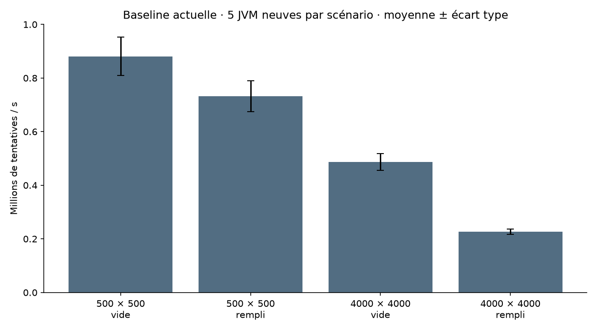

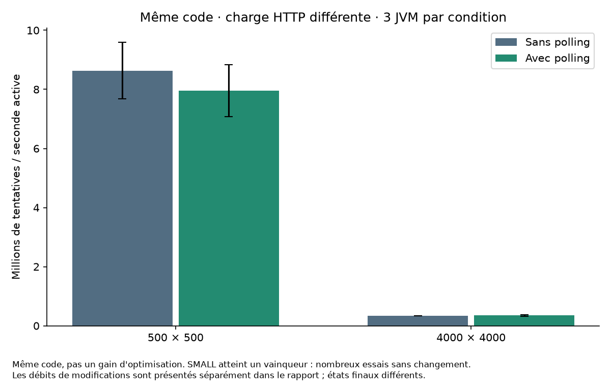

| Scénario | Actions moyennes | Modifications/s moyennes | CPU moteur moyen (ms) | Alloué/action (octets) | Pic heap moyen (Mio) |
|---|---:|---:|---:|---:|---:|
| engine 500, empty, none | 170 000,00 | 869 632,18 | 1 896,88 | 4 109,15 | 672,30 |
| engine 500, full, none | 84 000,00 | 714 003,81 | 1 137,50 | 4 917,85 | 409,13 |
| engine 4000, empty, none | 81 000,00 | 486 623,46 | 1 646,88 | 5 284,57 | 562,49 |
| engine 4000, full, none | 24 000,00 | 221 070,44 | 1 037,50 | 5 633,20 | 717,16 |
| application 500, empty, no-polling | 17 277 646,00 | 219 795,99 | 19 562,50 | 445,61 | 1 228,65 |
| application 500, empty, polling | 15 925 854,67 | 221 341,32 | 19 552,08 | 456,59 | 1 228,87 |
| application 4000, empty, no-polling | 677 905,33 | 338 444,94 | 19 609,38 | 2 372,73 | 1 416,48 |
| application 4000, empty, polling | 693 541,33 | 346 315,06 | 19 630,21 | 2 365,57 | 1 448,99 |

Les actions, conversions et éliminations de chaque essai sont dans [workload-verification.csv](02-compteurs/workload-verification.csv). Les tableaux supplémentaires CPU processus, attentes et percentiles conservent leur dispersion dans summary.csv. Aucune amélioration d'allocation ou mémoire n'est attribuée à cette étude sans changement. La mémoire des couleurs reste celle du byte[] de l'étape 01 : **250016 octets pour SMALL et 16000016 octets pour DEFAULT**, observés par Instrumentation, hors autres index.

### Requêtes et fenêtres applicatives réellement obtenues

| Essai | Temps actif / mural (s) | Actions | Requêtes / erreurs | P50 / P95 / P99 (ms) | CPU processus (ms) |
|---|---|---:|---|---|---:|
| application-4000-empty-no-polling-s11-p1-baseline | 20,005 / 20,007 | 665020 | 0 / 0 | — / — / — | 20 109,38 |
| application-4000-empty-no-polling-s11-p2-baseline | 20,037 / 20,042 | 686868 | 0 / 0 | — / — / — | 19 968,75 |
| application-4000-empty-no-polling-s11-p3-baseline | 20,048 / 20,052 | 681828 | 0 / 0 | — / — / — | 19 875,00 |
| application-4000-empty-polling-s11-p1-baseline | 20,040 / 20,044 | 707552 | 80 / 0 | 23,937 / 96,411 / 111,230 | 20 734,38 |
| application-4000-empty-polling-s11-p2-baseline | 20,015 / 20,019 | 753280 | 80 / 0 | 28,020 / 121,451 / 146,175 | 20 734,38 |
| application-4000-empty-polling-s11-p3-baseline | 20,025 / 20,027 | 619792 | 80 / 0 | 12,614 / 82,752 / 129,151 | 20 343,75 |
| application-500-empty-no-polling-s11-p1-baseline | 20,003 / 20,006 | 19458797 | 0 / 0 | — / — / — | 21 140,62 |
| application-500-empty-no-polling-s11-p2-baseline | 20,009 / 20,013 | 16532892 | 0 / 0 | — / — / — | 20 625,00 |
| application-500-empty-no-polling-s11-p3-baseline | 20,008 / 20,012 | 15841249 | 0 / 0 | — / — / — | 20 375,00 |
| application-500-empty-polling-s11-p1-baseline | 20,014 / 20,019 | 14482485 | 80 / 0 | 2,702 / 27,775 / 39,745 | 20 812,50 |
| application-500-empty-polling-s11-p2-baseline | 20,011 / 20,013 | 17862889 | 80 / 0 | 2,617 / 37,618 / 61,995 | 20 734,38 |
| application-500-empty-polling-s11-p3-baseline | 20,023 / 20,029 | 15432190 | 80 / 0 | 2,517 / 75,371 / 89,048 | 21 421,88 |

Les percentiles sans polling sont absents (—), pas nuls. Les 20 secondes sont un minimum demandé ; temps actif et temps mural peuvent différer à cause des commandes. Les 3 répétitions sont trop peu nombreuses pour prétendre à une estimation précise des queues de latence. Aucun percentile global mélangeant les tailles n'est calculé.

## Profils réels et interprétation

### application-profile-4000-empty-no-polling-s11-p0-baseline.summary.json

[Export intégral](02-compteurs/profiles/application-profile-4000-empty-no-polling-s11-p0-baseline.summary.json) et [JFR original](02-compteurs/profiles/application-profile-4000-empty-no-polling-s11-p0-baseline.jfr) dans l'archive de remise. CPU inclusif, exclusif et piles d'allocations sont conservés.

CPU exclusif dominant : `org.pixelwar.pixelwar.domain.FrontierPlacementStrategy.potential` : 465 samples ; `org.pixelwar.pixelwar.domain.FrontierPlacementStrategy.conquestScore` : 378 samples ; `org.pixelwar.pixelwar.domain.Board.updateFrontiers` : 279 samples ; `org.pixelwar.pixelwar.domain.Board.place` : 80 samples ; `org.pixelwar.pixelwar.domain.NeighborConversion.detect` : 30 samples.

Allocations estimées : `org.pixelwar.pixelwar.domain.PlacementStrategy$Position` : 892,02 Mio ; `[Lorg.pixelwar.pixelwar.domain.CellState;` : 201,97 Mio ; `java.lang.Long` : 200,98 Mio ; `[Ljava.lang.Object;` : 50,56 Mio ; `[I` : 40,34 Mio.

Collections GC (durée totale) : 6,42 ms ; pauses GCPhasePause : 6,42 ms. Ce sont deux mesures distinctes.

| Classe du moniteur | Événements ≥ 1 ms | Attente cumulée (ms) |
|---|---:|---:|
| `jdk.jfr.internal.PlatformRecorder` | 1 | 2,37 |

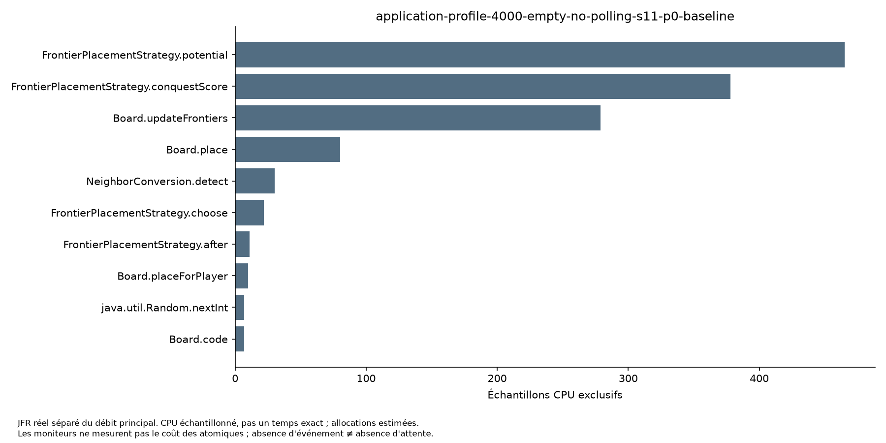

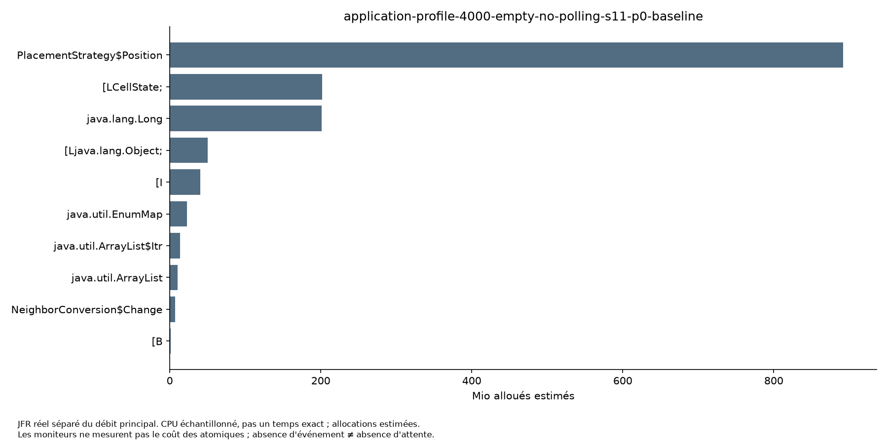

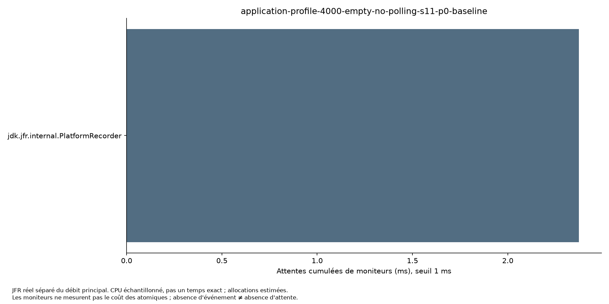
### application-profile-4000-empty-polling-s11-p0-baseline.summary.json

[Export intégral](02-compteurs/profiles/application-profile-4000-empty-polling-s11-p0-baseline.summary.json) et [JFR original](02-compteurs/profiles/application-profile-4000-empty-polling-s11-p0-baseline.jfr) dans l'archive de remise. CPU inclusif, exclusif et piles d'allocations sont conservés.

CPU exclusif dominant : `org.pixelwar.pixelwar.domain.FrontierPlacementStrategy.potential` : 557 samples ; `org.pixelwar.pixelwar.domain.FrontierPlacementStrategy.conquestScore` : 551 samples ; `org.pixelwar.pixelwar.domain.Board.updateFrontiers` : 306 samples ; `org.pixelwar.pixelwar.domain.Board.place` : 107 samples ; `org.pixelwar.pixelwar.domain.NeighborConversion.detect` : 33 samples.

Allocations estimées : `org.pixelwar.pixelwar.domain.PlacementStrategy$Position` : 966,08 Mio ; `java.lang.Long` : 213,42 Mio ; `[Lorg.pixelwar.pixelwar.domain.CellState;` : 186,39 Mio ; `[Ljava.lang.Object;` : 58,01 Mio ; `[I` : 36,24 Mio.

Collections GC (durée totale) : 2,51 ms ; pauses GCPhasePause : 2,51 ms. Ce sont deux mesures distinctes.

| Classe du moniteur | Événements ≥ 1 ms | Attente cumulée (ms) |
|---|---:|---:|
| `org.pixelwar.pixelwar.domain.Simulation` | 98 | 4 288,52 |
| `jdk.jfr.internal.PlatformRecorder` | 1 | 2,17 |
| `tools.jackson.databind.ser.SerializerCache` | 1 | 1,41 |

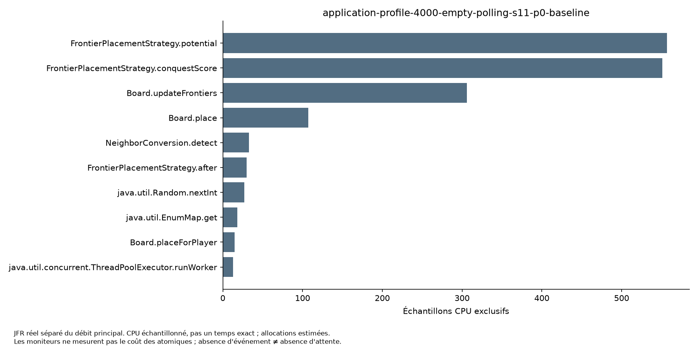

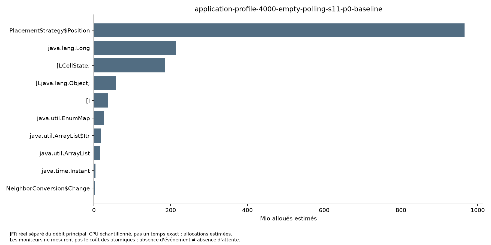

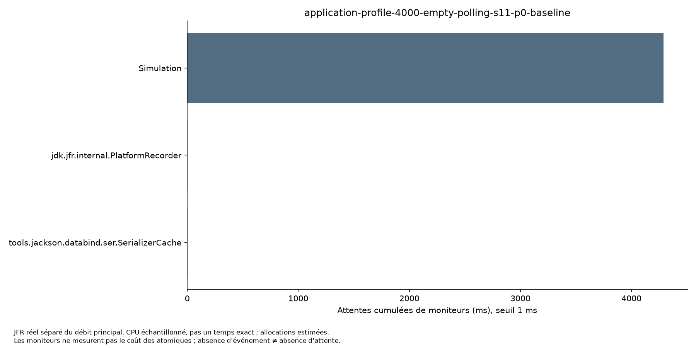
### profile-4000-full-s11-p0-baseline.summary.json

[Export intégral](02-compteurs/profiles/profile-4000-full-s11-p0-baseline.summary.json) et [JFR original](02-compteurs/profiles/profile-4000-full-s11-p0-baseline.jfr) dans l'archive de remise. CPU inclusif, exclusif et piles d'allocations sont conservés.

CPU exclusif dominant : `org.pixelwar.pixelwar.domain.FrontierPlacementStrategy.conquestScore` : 70 samples ; `org.pixelwar.pixelwar.domain.FrontierPlacementStrategy.score` : 57 samples ; `org.pixelwar.pixelwar.domain.Board.updateFrontiers` : 45 samples ; `org.pixelwar.pixelwar.domain.FrontierPlacementStrategy.potential` : 16 samples ; `java.util.ArrayList.grow` : 13 samples.

Allocations estimées : `[Lorg.pixelwar.pixelwar.domain.CellState;` : 270,98 Mio ; `org.pixelwar.pixelwar.domain.PlacementStrategy$Position` : 129,49 Mio ; `java.lang.Long` : 39,99 Mio ; `org.pixelwar.pixelwar.domain.NeighborConversion$Change` : 10,25 Mio ; `[Ljava.lang.Object;` : 8,27 Mio.

Collections GC (durée totale) : 0,00 ms ; pauses GCPhasePause : 0,00 ms. Ce sont deux mesures distinctes.

| Classe du moniteur | Événements ≥ 1 ms | Attente cumulée (ms) |
|---|---:|---:|
| `jdk.jfr.internal.PlatformRecorder` | 1 | 6,08 |

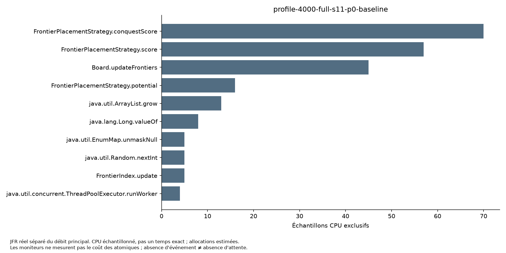

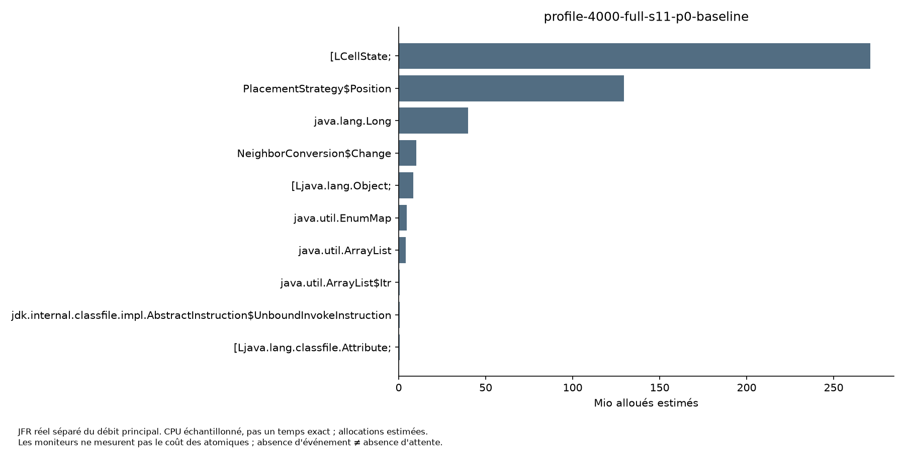

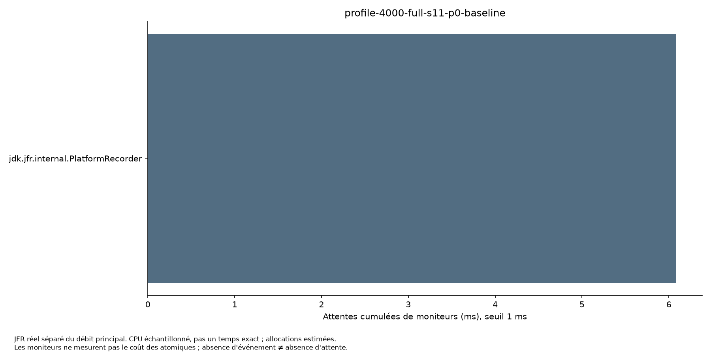

Les incréments primitifs sont susceptibles d'être inlinés ; un profil échantillonné ne sépare pas leur coût de leur méthode englobante. Aucune absence de symbole AtomicLong dans une pile n'est interprétée comme preuve de coût nul. C'est l'inspection des champs et de tous les chemins d'accès qui établit l'absence de candidat. Les moniteurs mesurent un autre mécanisme que les instructions atomiques ; leur fréquence ne mesure pas le coût d'un CAS. Les temps cumulés de threads peuvent dépasser le temps mural et les événements inférieurs au seuil ne sont pas comptés.

Les méthodes et classes dominantes affichées ci-dessus orientent une prochaine hypothèse vers la stratégie de frontière, les allocations de coordonnées/collections et le coût de lecture/aperçu sous polling, selon le scénario. Cette étude ne modifie aucun de ces chemins et ne prouve pas qu'une refonte particulière les améliorerait. Les profils ne sont pas des mesures de scalabilité parallèle.

## Correction, tests et limites

[Tests de construction](02-compteurs/logs/build-baseline.log), [rejeux](02-compteurs/replay-verification.json), [invariants](02-compteurs/workload-verification.csv) et [inventaire des sources](02-compteurs/source-inventory.json) sont conservés. Les invariants vérifient pour chaque snapshot global la somme des compteurs par joueur, l'attribution des conversions, changements = modifications + conversions et somme des couleurs = surface, avec le même état spatial pour les rejeux. Les durées et mesures JVM sont exclues de l'égalité. Le stock est désactivé dans les benchmarks ; la validation du stock activé reste celle des tests métier existants.

Aucun compteur modifié, donc aucun nouveau test concurrent de remplacement n'est ajouté. Les tests existants couvrent notamment pose alliée sans débit du stock, action sans stock, attribution après pose sans changement, conversions différées/simultanées, erreur partielle, reset, ancienne génération et pause/stop. Le test scheduler historique utilise des attentes temporisées et ne constitue pas une nouvelle preuve exhaustive de tous les entrelacements ; le test du filtre utilise des latches, avec libération temporisée. Cette limite est déclarée, sans présenter ces tests comme un nouveau protocole par barrières. Le maintien bit pour bit du code de production est ici la garantie de non-régression du changement livré (banc/documentation uniquement).

La cohérence ne s'exige que dans un même snapshot sous son verrou. Deux requêtes différentes peuvent naturellement voir des actions différentes. Les objets Stock et PerformanceTracker ne sont pas déclarés thread-safe isolément. Un Board injecté doit respecter ses propres méthodes synchronisées ; il ne rend pas les mutations externes transactionnelles avec les métriques Simulation.

Aucun échec de solution n'a été inventé. Le lancement Maven initial sous sandbox a échoué avant tests ; le journal initial disponible et la reconstruction autorisée ont réussi. Une éventuelle panne du banc doit rester dans les journaux et ne serait pas une régression des compteurs. Pas de JMH : aucun microbenchmark facultatif ni optimisation fictive n'est nécessaire pour établir la non-applicabilité.

## Conclusion et reproduction

**Conserver la version actuelle ; ne pas modifier les compteurs.** Accélération temporelle `temps avant / temps après`, variation du débit `100 × (débit après / débit avant − 1)` et réduction de temps `100 × (1 − temps après / temps avant)` : non applicables faute de candidat après. Le gain marginal 02 et le gain cumulé depuis V3 restent non mesurés ; on n'additionne pas les pourcentages de l'étape 01. La comparaison polling/sans polling est une comparaison de charges différentes sur le même code, pas un avant/après de production.

Commande principale exécutée depuis la racine du dépôt, avec JDK et versions de Python documentés :

```powershell
$env:PYTHONPATH='C:/Users/gui35/ideaProjects/pixel-war/target/opti-01/python-libs'
.\scripts\benchmark-opti-02.ps1 -Reference c5a8777bcd9e967ca23ea451a06489b76a3e8ad6 -Java 'C:/Users/gui35/.jdks/openjdk-27/bin/java.exe' -Python 'C:/Python314/python.exe' -ResultsDir 'C:/Users/gui35/ideaProjects/pixel-war/target/opti-02/results' -Phase All -Resume
```

Installer au besoin `scripts/opti02/requirements.txt` dans un environnement Python isolé. Utiliser un ResultsDir neuf et omettre `-Resume` pour refaire toute la campagne. Le pilote reconstruit depuis `git archive`, teste, calibre, lance les JVM, exporte les JFR et appelle `scripts/opti02/analyze.py` pour les CSV, figures et ce rapport. `-Resume` ne reprend que les essais manquants et vérifie les commits. Le banc Java exact est dans le commit mesuré ; les scripts d'analyse et de remise sont dans le commit de livraison. L'archive contient aussi le binaire et l'agent réellement mesurés, les références, sources du banc et patch. Le dépôt Git avec la référence indiquée, JDK complet, dépendances Maven, Windows PowerShell et Python sont nécessaires pour recompiler ; aucune clé ni dossier .git complet n'est livré.

Le script `scripts/opti02/deliver.py <results> <repo> <archive>` publie les preuves et crée `target/audit-opti-02.zip`, contrôle SHA-256 et liens Markdown après extraction. [Index](02-compteurs/INDEX.md), [dictionnaire](02-compteurs/DICTIONNAIRE.md). JFR remplace le rôle de pprof ; le pilote PowerShell orchestre les forks à la place d'Hyperfine, mais exclut le démarrage JVM du chronométrage Java. Leur acceptation au barème relève de l'évaluateur.

## Correspondance avec le barème

| Critère | Points | Statut | Section et preuve | Reste / limite |
|---|---:|---|---|---|
| Environnement et métrologie | 3 | Partiel | Environnement/protocole, CSV individuels, 5 répétitions moteur, 3 par condition HTTP | Pas de candidat donc pas de paires avant/après ; SMALL applicatif atteint un vainqueur, taux de tentatives non représentatif de travail utile ; fréquence/affinité et stabilité JIT non contrôlées |
| Diagnostic et profiling réel | 5 | Couvert pour cette étude | Inventaire et trois JFR DEFAULT, CPU/allocations/moniteurs et vues annotées | Coût exact des incréments inlinés non isolé ; pas de counters matériel |
| Journal d'optimisation | 5 | Couvert pour cette étude | Diagnostic préalable, inventaire de tous les accès, aucun retrait de verrou | Aucun gain ni preuve de scalabilité parallèle |
| Échec constructif | 3 | Non traité | Non-applicabilité établie sans expérience artificielle | Pas de tentative de production réellement régressive |
| Reproductibilité et synthèse | 4 | Couvert pour cette étude | Script unique de campagne, synthèse, sources, raw, figures, archive et manifeste | Dépôt et dépendances requis ; archive vérifiée après extraction |
| Gouvernance IA | +2 | Non traité | Aucun constitution.md trouvé avec quatre directives | Le prompt de mission ne suffit pas à valider ce bonus |

Cette remise est une étude de choix de synchronisation. Elle ne valide ni l'audit final, ni réseau/persistance, ni parallélisme. Les profils avant/après sont non applicables en l'absence de modification ; les profils actuels exigés pour le diagnostic sont fournis. Les départs remplis applicatifs ne sont pas mesurés, comme à l'étape 01. Tout résultat absent reste explicitement absent.
