# O3 — positions primitives dans la sélection de frontière

## Synthèse intégrable à l’audit final

Pixel War doit traiter DEFAULT (4000 × 4000, 64 fois SMALL) sans modifier la partie simulée. Après O1 (board compact) et O2 (aucun atomique redondant à retirer), O3 vise les objets temporaires de sélection. Le profil O2 DEFAULT avec polling estimait 1 013 007 032 octets d’objets Position, soit environ 966 Mio ; ce poids échantillonné ne prouvait pas un coût exclusif de la boucle.

Le changement tire les mêmes identifiants de frontière, garde le meilleur dans un `int` et évalue avec des coordonnées primitives. Une `Position` est construite à la fin ; exploration, repli, ordre RNG, formule de score, synchronisations et règles sont conservés. Le décodage modulo/division est fait une fois par occurrence, puis pour le gagnant. Les signatures historiques restent des adaptateurs.

| Scénario | Octets/action avant → après | k tentatives/s avant → après | CPU moteur (s) avant → après |
|---|---:|---:|---:|
| 500 empty | 2 755,59 → 1 458,52 | 1 038,12 → 969,32 | 0,49 → 0,53 |
| 500 full | 4 925,75 → 3 630,33 | 757,99 → 768,54 | 0,64 → 0,65 |
| 4000 empty | 4 677,07 → 3 381,17 | 507,94 → 484,63 | 1,96 → 2,11 |
| 4000 full | 5 590,16 → 4 294,62 | 254,85 → 247,88 | 1,00 → 1,03 |

Les moyennes portent sur cinq JVM par variante et scénario, graine 11. Les dispersions figurent en annexe. Validation : 70 tests avant, 73 après ; douze rejeux réels (500/4000, vide/rempli, graines 11/22/33) et toutes les paires moteur/profil vérifient état métier et empreinte spatiale. Les tests tracent les types, bornes, retours et l’ordre RNG contre la stratégie historique figée. Les fenêtres ayant atteint la victoire sont exclues des conclusions de capacité utile (0 essai(s) principal(aux) signalé(s)). Le gain cumulé face à V3 reste non mesuré.

Décision : conserver pour la réduction d’allocations, en signalant les régressions de débit mesurées. Les accès Board et le scoring restent des coûts à examiner dans les profils. Les autres optimisations sont hors périmètre.

## 1. Références, environnement et diagnostic

Départ utilisateur : `a73c938c68e11174b5687c094efcf20d505b1b0f`, branche `refacto_metriques` préservée. Branche de travail : `opti/03-positions-primitives`.
Avant mesuré : `ea462e19e55e6f8f7366358918f07d9dfed6f7bb` ; après mesuré : `f61ad8fb6c3bb186dc7043954918ca8498db0513`. Le commit de banc avant ne modifie pas la production. L’après inclut uniquement les deux fichiers de production de sélection et les tests. Voir [build avant](03-positions-primitives/build-before.json), [build après](03-positions-primitives/build-after.json) et [patch](03-positions-primitives/patches/optimisation.patch).

CPU : 13th Gen Intel(R) Core(TM) i5-13600KF, 14 cœurs physiques / 20 logiques ; RAM 34188517376 octets. OS : Microsoft Windows 11 Famille 10.0.26300 64 bits. Caches CIM : L2 20480 Kio, L3 24576 Kio ; L1 et topologie fine non mesurés.

OpenJDK 27, compilation Java 21 ; flags identiques `-Xms2g -Xmx2g -XX:+UseG1GC` ; agent Instrumentation commun. [Environnement effectif](03-positions-primitives/environment.json), [JVM](03-positions-primitives/java-version.txt), [Maven](03-positions-primitives/maven-version.txt), [dépendances de tracé](03-positions-primitives/plot-dependencies.json), [commandes](03-positions-primitives/COMMANDES.md). Aucun réglage d’affinité, température ou fréquence ; bruit Windows possible.

Inspection avant : Board.randomFrontierPosition tirait un id dans FrontierIndex puis matérialisait un record par occurrence ; choose renvoyait le meilleur objet. Les autres allocations (`CellState.values`, Long/EnumMap, conversions) sont conservées. Le code de production au départ est identique à la référence O2 `c5a8777`, ce qui autorise le profil existant comme diagnostic préalable ; les nouveaux profils comparent les deux variantes actuelles.

## 2. Changement et validation

`Board.randomFrontierId`, de visibilité package et synchronisé, conserve validation de couleur, ordre de stockage et FrontierIndex.randomId. La sentinelle `-1` désigne une frontière vide sans tirage ; l’adaptateur public la traduit en null. Dans choose, frontière vérifiée non vide et échantillonnage sous le même moniteur excluent une disparition en cours de boucle. Aucun nouveau tirage de récupération n’est ajouté.

`FrontierPlacementStrategy` conserve le nextDouble initial, les doublons, le réservoir de départage, les lectures/courts-circuits, l’arrondi de faiblesse et la priorité. Scoring et anticipation partagent une implémentation primitive ; les adaptateurs Position évitent une divergence. Aucun objet mutable réutilisé, pooling, boxing ou tableau de coordonnées par candidat. La réduction des constructions est une propriété du source ; les octets/action ci-dessous mesurent le résultat de la JVM.

Les tests PrimitivePositionTests confrontent la nouvelle sélection à ObjectFrontierReference, copie de l’avant : explorations 0/0,1/1, tailles d’échantillon 1/10, doublons forcés, égalités, vide/rempli, bords et rectangle, mutation entre poses, reset, score et bonus. Les tests existants de stock, conversions, API, pause/stop/reset restent exécutés.

Les rejeux mesurent 10 000 actions réelles avec premier joueur tournant par tour ; état initial et RNG recréés, empreinte SHA-256 cellule par cellule. Comparaison complète des snapshots métier : couleurs, tailles de frontières, compteurs par joueur, stock, éliminations et cibles prioritaires. Les durées et ressources JVM sont exclues. Les frontières sont comparées par tailles et leurs invariants sont couverts par les tests ; il ne s’agit pas d’une preuve exhaustive de leur stockage interne sur 16 millions de cellules. [Comparaisons](03-positions-primitives/replay-verification.json), [cohérence des charges](03-positions-primitives/workload-verification.csv), [bilan](03-positions-primitives/validation.json), [tests avant](03-positions-primitives/logs/build-before.log), [tests après](03-positions-primitives/logs/build-after.log).

## 3. Protocole de mesure

Une action est une exécution réelle pour un joueur non éliminé ; une tentative est une pose essayée ; une modification est un changement direct ; une conversion est un changement appliqué dans une passe simultanée sur état stable. Un appel pour un éliminé ne gonfle pas les actions.

Chaque JVM est neuve ; variantes séquentielles, ordre avant/après alterné dans les cinq paires moteur et trois paires applicatives par taille/condition. Moteur : chauffe de 3 s sur un jeu jetable, recréation du plateau et RNG, construction/préparation/GC/empreintes hors chronométrage. Le budget est calibré avant, cible 2 s, plafonné à 50 000 actions SMALL et 100 000 DEFAULT pour borner la phase de jeu, puis figé identiquement ; les durées réellement obtenues peuvent être inférieures à 2 s. [Budgets](03-positions-primitives/budgets.json). Le plein pseudo-aléatoire est préparé par Board.place avec Random(seed+1000), en conservant les candidats de conversion de préparation. Première passe dense incluse.

Paramètres : frontier, exploration 0,10, dix candidats et dix tentatives/action, bonus 8, priorité 20 actions, conversions actives, stock désactivé, cadence demandée 10 ns, aperçu 500 × 500. Graines : 11 pour les performances ; 11/22/33 pour les rejeux. Aucune comparaison directe à l’ancien débit O1 fondé sur le temps mural.

Application : chauffe métier jetable de 3 s avant création du serveur, puis 0,2 s du scheduler sur le jeu mesuré. SMALL utilise une fenêtre cible de 1 s pour limiter le risque de victoire, DEFAULT 20 s ; ce protocole est distinct des 5 s de chauffe et 20 s d’O2. Il ne démontre pas la stabilisation complète de la JVM HTTP sur SMALL : ce résultat court reste complémentaire. Le temps inclut la demande de pause finale ; la durée réelle est enregistrée, le temps actif exact définit le débit. Les batchs HTTP attendent les quatre GET concurrents de la seconde : simulation, scores, performance, preview ; réponses intégrales, latences client et transferts compris. Si un batch dépasse une seconde, la cadence réelle diminue et la fenêtre peut déborder. Sans polling : commandes et snapshots de pilotage uniquement.

La victoire est observée sans changer la production : moteur après chaque tour (au plus quatre appels), application par observateur interne toutes les 10 ms demandées sous Simulation. Le dernier constat contesté et le premier constat de victoire bornent le passage ; un retard de scheduling/verrou peut élargir cet intervalle, donc 10 ms n’est pas une borne garantie. Éliminations monotones : états début/fin et détection permettent d’exclure toute fenêtre post-victoire. L’observateur ajoute des prises de verrou identiques avant/après, y compris sans polling. Aucun débit partiel avant victoire n’est reconstruit à partir des totaux.

CPU principal : delta du thread moteur. Application : PerformanceTracker pour moteur et MXBean séparé pour processus. Allocations/action : delta du thread moteur, pas allocation retenue. Pic heap échantillonné toutes les 10 ms et dépendant du GC. Les compteurs GC moteur encadrent aussi les snapshots/empreintes après travail : ils restent complémentaires et ne sont pas attribués exclusivement au chronométrage métier.

## 4. Résultats détaillés

Le fichier [summary.csv](03-positions-primitives/summary.csv) conserve moyenne, médiane, écart type, variance d’échantillon (n−1), min/max et n pour chaque mesure, taille, état, condition et variante. [Observations](03-positions-primitives/observations.csv), [rapports par paire](03-positions-primitives/pairs.csv), [dispersion des variations appariées](03-positions-primitives/pair-summary.csv). Une variation de moyenne ne constitue pas un test de significativité.

| Scénario / mesure | Avant, moyenne | Après, moyenne | Variation | n avant/après |
|---|---:|---:|---:|---:|
| 500 empty none / temps fixe (s) | 0,49 | 0,53 | 8,22 % | 5/5 |
| 500 empty none / octets/action | 2 755,59 | 1 458,52 | -47,07 % | 5/5 |
| 500 empty none / tentatives/s | 1 038 117,63 | 969 320,61 | -6,63 % | 5/5 |
| 500 empty none / modifications/s | 1 038 117,63 | 969 320,61 | -6,63 % | 5/5 |
| 500 empty none / CPU moteur (s) | 0,49 | 0,53 | 7,01 % | 5/5 |
| 500 empty none / pic heap (Mio) | 137,13 | 75,32 | -45,07 % | 5/5 |
| 500 full none / temps fixe (s) | 0,66 | 0,65 | -1,43 % | 5/5 |
| 500 full none / octets/action | 4 925,75 | 3 630,33 | -26,30 % | 5/5 |
| 500 full none / tentatives/s | 757 992,45 | 768 538,23 | 1,39 % | 5/5 |
| 500 full none / modifications/s | 738 889,52 | 749 169,53 | 1,39 % | 5/5 |
| 500 full none / CPU moteur (s) | 0,64 | 0,65 | 1,46 % | 5/5 |
| 500 full none / pic heap (Mio) | 250,15 | 188,13 | -24,79 % | 5/5 |
| 4000 empty none / temps fixe (s) | 1,99 | 2,15 | 7,96 % | 5/5 |
| 4000 empty none / octets/action | 4 677,07 | 3 381,17 | -27,71 % | 5/5 |
| 4000 empty none / tentatives/s | 507 942,89 | 484 629,93 | -4,59 % | 5/5 |
| 4000 empty none / modifications/s | 507 942,89 | 484 629,93 | -4,59 % | 5/5 |
| 4000 empty none / CPU moteur (s) | 1,96 | 2,11 | 7,32 % | 5/5 |
| 4000 empty none / pic heap (Mio) | 596,90 | 477,10 | -20,07 % | 5/5 |
| 4000 full none / temps fixe (s) | 1,02 | 1,05 | 2,98 % | 5/5 |
| 4000 full none / octets/action | 5 590,16 | 4 294,62 | -23,18 % | 5/5 |
| 4000 full none / tentatives/s | 254 847,63 | 247 879,38 | -2,73 % | 5/5 |
| 4000 full none / modifications/s | 248 385,28 | 241 593,73 | -2,73 % | 5/5 |
| 4000 full none / CPU moteur (s) | 1,00 | 1,03 | 3,12 % | 5/5 |
| 4000 full none / pic heap (Mio) | 727,37 | 695,17 | -4,43 % | 5/5 |

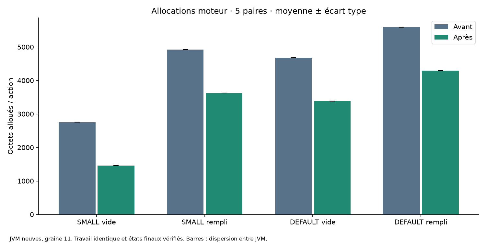

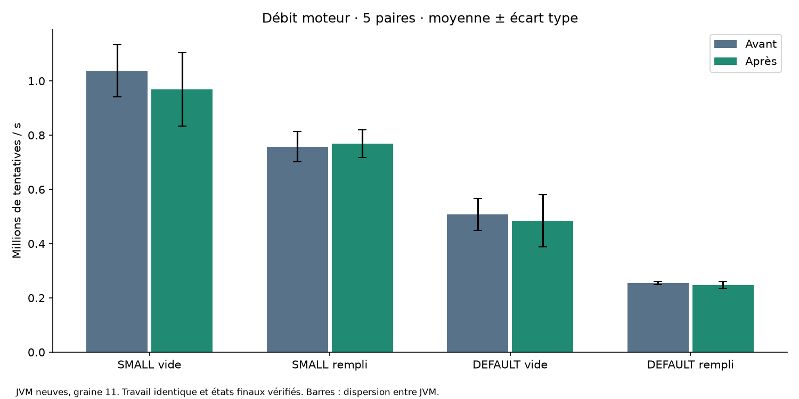

### Application et phase de jeu

| Scénario / mesure | Avant, moyenne | Après, moyenne | Variation | n avant/après |
|---|---:|---:|---:|---:|
| 500 empty no-polling / tentatives/s actif | 836 181,58 | 848 592,67 | 1,48 % | 3/3 |
| 500 empty no-polling / modifications/s actif | 827 078,00 | 841 308,83 | 1,72 % | 3/3 |
| 500 empty no-polling / octets/action moteur | 4 096,56 | 2 676,32 | -34,67 % | 3/3 |
| 500 empty no-polling / CPU moteur (s) | 1,31 | 0,99 | -24,60 % | 3/3 |
| 500 empty no-polling / CPU processus (s) | 1,44 | 1,07 | -25,36 % | 3/3 |
| 500 empty polling / tentatives/s actif | 894 331,17 | 813 676,34 | -9,02 % | 3/3 |
| 500 empty polling / modifications/s actif | 885 894,10 | 807 708,79 | -8,83 % | 3/3 |
| 500 empty polling / octets/action moteur | 4 035,83 | 2 604,74 | -35,46 % | 3/3 |
| 500 empty polling / CPU moteur (s) | 0,99 | 0,98 | -1,05 % | 3/3 |
| 500 empty polling / CPU processus (s) | 1,18 | 1,21 | 2,65 % | 3/3 |
| 4000 empty no-polling / tentatives/s actif | 369 844,80 | 368 255,04 | -0,43 % | 3/3 |
| 4000 empty no-polling / modifications/s actif | 369 844,80 | 368 255,04 | -0,43 % | 3/3 |
| 4000 empty no-polling / octets/action moteur | 2 307,93 | 1 011,76 | -56,16 % | 3/3 |
| 4000 empty no-polling / CPU moteur (s) | 19,72 | 19,73 | 0,03 % | 3/3 |
| 4000 empty no-polling / CPU processus (s) | 20,55 | 20,58 | 0,15 % | 3/3 |
| 4000 empty polling / tentatives/s actif | 332 670,37 | 321 800,06 | -3,27 % | 3/3 |
| 4000 empty polling / modifications/s actif | 332 670,37 | 321 800,06 | -3,27 % | 3/3 |
| 4000 empty polling / octets/action moteur | 2 301,72 | 950,99 | -58,68 % | 3/3 |
| 4000 empty polling / CPU moteur (s) | 19,53 | 19,47 | -0,29 % | 3/3 |
| 4000 empty polling / CPU processus (s) | 21,04 | 20,77 | -1,26 % | 3/3 |

Les essais non représentatifs sont conservés dans les données et signalés : aucun essai principal. Leur débit ne mesure pas la capacité d’affrontement. Les états applicatifs finaux peuvent différer : il s’agit de fenêtres à durée commune, pas de budgets d’actions identiques.

| Scénario / mesure | Avant, moyenne | Après, moyenne | Variation | n avant/après |
|---|---:|---:|---:|---:|
| 500 empty polling / HTTP P50 (ms) | 13,14 | 4,74 | -63,96 % | 3/3 |
| 500 empty polling / HTTP P95 (ms) | 41,03 | 35,79 | -12,77 % | 3/3 |
| 500 empty polling / HTTP P99 (ms) | 41,03 | 35,79 | -12,77 % | 3/3 |
| 4000 empty polling / HTTP P50 (ms) | 21,71 | 18,95 | -12,72 % | 3/3 |
| 4000 empty polling / HTTP P95 (ms) | 144,56 | 94,37 | -34,72 % | 3/3 |
| 4000 empty polling / HTTP P99 (ms) | 174,21 | 157,03 | -9,87 % | 3/3 |

Les percentiles sont nearest rank ceil(p×n), par essai. Le tableau résume leur moyenne entre JVM ; ce n’est pas un percentile global fusionné. Erreurs et requêtes individuelles figurent dans chaque JSON. Sans polling, percentiles non mesurés, jamais zéro.

### Dispersion moteur et rapports appariés

| Scénario / mesure | Variante | Moyenne | Médiane | Écart type | Variance n−1 (unité²) | n |
|---|---|---:|---:|---:|---:|---:|

| 4000 empty / elapsedNanos (s) | after | 2,15 | 1,95 | 0,55 | 0,30 | 5 |
| 4000 empty / cpuNanos (s) | after | 2,11 | 1,92 | 0,52 | 0,28 | 5 |
| 4000 empty / allocatedBytesPerAction (octets/action) | after | 3 381,17 | 3 381,17 | 0,08 | 0,01 | 5 |
| 4000 empty / attemptsPerSecond (tentatives/s) | after | 484 629,93 | 513 647,49 | 96 683,94 | 9 347 783 726,74 | 5 |
| 4000 empty / elapsedNanos (s) | before | 1,99 | 1,91 | 0,25 | 0,06 | 5 |
| 4000 empty / cpuNanos (s) | before | 1,96 | 1,88 | 0,24 | 0,06 | 5 |
| 4000 empty / allocatedBytesPerAction (octets/action) | before | 4 677,07 | 4 677,05 | 0,08 | 0,01 | 5 |
| 4000 empty / attemptsPerSecond (tentatives/s) | before | 507 942,89 | 524 230,70 | 58 203,36 | 3 387 631 675,46 | 5 |
| 4000 full / elapsedNanos (s) | after | 1,05 | 1,02 | 0,05 | 0,00 | 5 |
| 4000 full / cpuNanos (s) | after | 1,03 | 1,00 | 0,07 | 0,00 | 5 |
| 4000 full / allocatedBytesPerAction (octets/action) | after | 4 294,62 | 4 294,36 | 0,58 | 0,34 | 5 |
| 4000 full / attemptsPerSecond (tentatives/s) | after | 247 879,38 | 256 016,49 | 12 148,29 | 147 580 870,64 | 5 |
| 4000 full / elapsedNanos (s) | before | 1,02 | 1,02 | 0,02 | 0,00 | 5 |
| 4000 full / cpuNanos (s) | before | 1,00 | 0,98 | 0,03 | 0,00 | 5 |
| 4000 full / allocatedBytesPerAction (octets/action) | before | 5 590,16 | 5 590,16 | 0,00 | 0,00 | 5 |
| 4000 full / attemptsPerSecond (tentatives/s) | before | 254 847,63 | 255 439,56 | 5 033,88 | 25 339 930,99 | 5 |
| 500 empty / elapsedNanos (s) | after | 0,53 | 0,51 | 0,08 | 0,01 | 5 |
| 500 empty / cpuNanos (s) | after | 0,53 | 0,50 | 0,08 | 0,01 | 5 |
| 500 empty / allocatedBytesPerAction (octets/action) | after | 1 458,52 | 1 458,78 | 0,52 | 0,27 | 5 |
| 500 empty / attemptsPerSecond (tentatives/s) | after | 969 320,61 | 971 770,65 | 135 891,79 | 18 466 579 797,64 | 5 |
| 500 empty / elapsedNanos (s) | before | 0,49 | 0,46 | 0,05 | 0,00 | 5 |
| 500 empty / cpuNanos (s) | before | 0,49 | 0,47 | 0,04 | 0,00 | 5 |
| 500 empty / allocatedBytesPerAction (octets/action) | before | 2 755,59 | 2 755,64 | 0,42 | 0,18 | 5 |
| 500 empty / attemptsPerSecond (tentatives/s) | before | 1 038 117,63 | 1 096 348,90 | 95 760,72 | 9 170 115 758,43 | 5 |
| 500 full / elapsedNanos (s) | after | 0,65 | 0,64 | 0,05 | 0,00 | 5 |
| 500 full / cpuNanos (s) | after | 0,65 | 0,64 | 0,05 | 0,00 | 5 |
| 500 full / allocatedBytesPerAction (octets/action) | after | 3 630,33 | 3 630,33 | 0,00 | 0,00 | 5 |
| 500 full / attemptsPerSecond (tentatives/s) | after | 768 538,23 | 787 013,52 | 50 996,53 | 2 600 645 618,91 | 5 |
| 500 full / elapsedNanos (s) | before | 0,66 | 0,69 | 0,05 | 0,00 | 5 |
| 500 full / cpuNanos (s) | before | 0,64 | 0,64 | 0,05 | 0,00 | 5 |
| 500 full / allocatedBytesPerAction (octets/action) | before | 4 925,75 | 4 925,75 | 0,00 | 0,00 | 5 |
| 500 full / attemptsPerSecond (tentatives/s) | before | 757 992,45 | 725 727,64 | 56 721,27 | 3 217 302 805,09 | 5 |

| Scénario / variation après÷avant − 1 (%) | Moyenne | Médiane | Écart type | Variance | n |
|---|---:|---:|---:|---:|---:|
| 4000 empty / elapsedNanos | 7,02 | 2,06 | 14,90 | 221,87 | 5 |
| 4000 empty / allocatedBytesPerAction | -27,71 | -27,71 | 0,00 | 0,00 | 5 |
| 4000 empty / attemptsPerSecond | -5,16 | -2,02 | 12,60 | 158,67 | 5 |
| 4000 full / elapsedNanos | 2,98 | 2,00 | 4,79 | 22,97 | 5 |
| 4000 full / allocatedBytesPerAction | -23,18 | -23,18 | 0,01 | 0,00 | 5 |
| 4000 full / attemptsPerSecond | -2,73 | -1,96 | 4,37 | 19,13 | 5 |
| 500 empty / elapsedNanos | 8,25 | 14,94 | 12,64 | 159,66 | 5 |
| 500 empty / allocatedBytesPerAction | -47,07 | -47,06 | 0,02 | 0,00 | 5 |
| 500 empty / attemptsPerSecond | -6,53 | -13,00 | 11,63 | 135,25 | 5 |
| 500 full / elapsedNanos | -1,17 | 1,66 | 7,57 | 57,31 | 5 |
| 500 full / allocatedBytesPerAction | -26,30 | -26,30 | 0,00 | 0,00 | 5 |
| 500 full / attemptsPerSecond | 1,67 | -1,63 | 7,93 | 62,91 | 5 |

## 5. Profils réels et limites causales

JFR CPU, allocations et moniteurs sont capturés dans des JVM séparées des mesures principales : moteur DEFAULT rempli et application DEFAULT sans/avec polling, avant/après. JavaMonitorEnter : seuil 1 ms, piles activées ; événements plus courts absents. CPU exclusif : sommet de pile, inclusif : méthode présente une fois par échantillon. Les poids ObjectAllocationSample sont estimés, pas des comptes exacts ni de la mémoire retenue. Les exports conservent les piles complètes ; les vues suivantes sont des barres comparatives des événements réellement collectés, pas des flamegraphs reconstruits. Les originaux JFR sont dans l’archive.

### profile-4000-full-s11-p0

| Variante | Actions | Position, octets estimés | Position, octets estimés/action | Échantillons CPU | GC / pauses (ms) |
|---|---:|---:|---:|---:|---|
| before | 26000 | 34602704 | 1 330,87 | 113 | 0,00 / 0,00 |

before : principales méthodes exclusives : org.pixelwar.pixelwar.domain.FrontierPlacementStrategy.score (52) ; org.pixelwar.pixelwar.domain.Board.updateFrontiers (21) ; java.util.ArrayList.grow (13) ; org.pixelwar.pixelwar.domain.FrontierPlacementStrategy.conquestScore (6). [Export complet](03-positions-primitives/profiles/profile-4000-full-s11-p0-before.summary.json).

Pile d’allocations Position (before) : `Board.randomFrontierPosition → FrontierPlacementStrategy.choose → Simulation.play → PositionExperiment.runActions` ; poids 34602704 octets estimés, 1 330,87 octets estimés/action. Pile complète conservée dans l’export, sans fusion avec les allocations d’autres classes.

| after | 26000 | 3145688 | 120,99 | 109 | 0,00 / 0,00 |

after : principales méthodes exclusives : org.pixelwar.pixelwar.domain.FrontierPlacementStrategy.score (45) ; org.pixelwar.pixelwar.domain.Board.updateFrontiers (21) ; java.util.ArrayList.grow (14) ; org.pixelwar.pixelwar.domain.Board.get (9). [Export complet](03-positions-primitives/profiles/profile-4000-full-s11-p0-after.summary.json).

Pile d’allocations Position (after) : `FrontierPlacementStrategy.choose → Simulation.play → PositionExperiment.runActions → PositionExperiment.main` ; poids 3145688 octets estimés, 120,99 octets estimés/action. Pile complète conservée dans l’export, sans fusion avec les allocations d’autres classes.

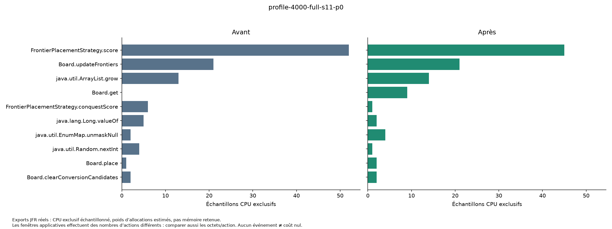

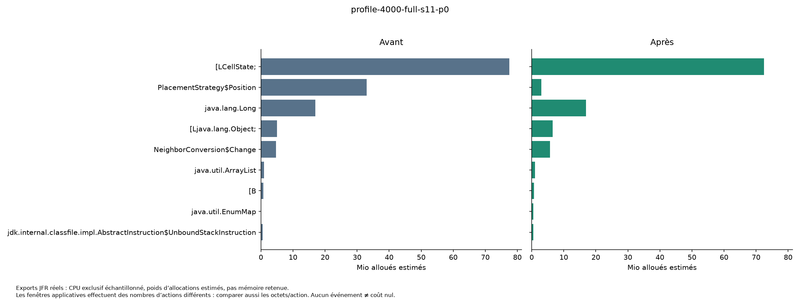

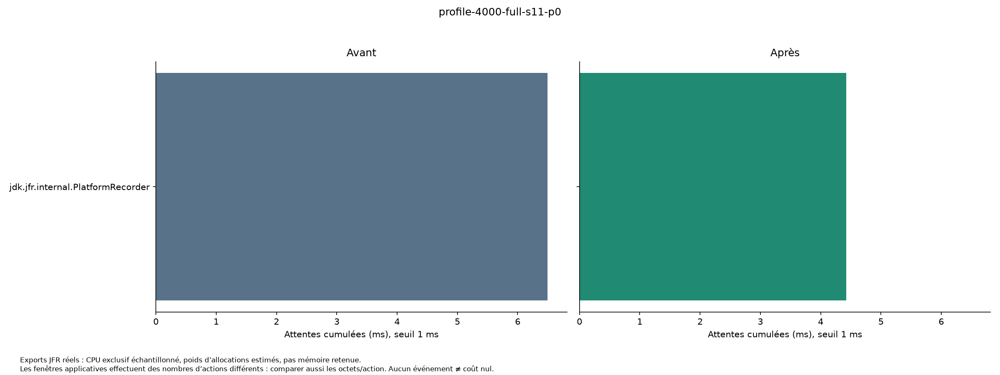

### application-profile-4000-empty-polling-s11-p0

| Variante | Actions | Position, octets estimés | Position, octets estimés/action | Échantillons CPU | GC / pauses (ms) |
|---|---:|---:|---:|---:|---|
| before | 613848 | 910439656 | 1 483,17 | 1894 | 26,51 / 26,51 |

before : principales méthodes exclusives : org.pixelwar.pixelwar.domain.FrontierPlacementStrategy.potential (633) ; org.pixelwar.pixelwar.domain.FrontierPlacementStrategy.conquestScore (543) ; org.pixelwar.pixelwar.domain.Board.updateFrontiers (391) ; org.pixelwar.pixelwar.domain.Board.place (126). [Export complet](03-positions-primitives/profiles/application-profile-4000-empty-polling-s11-p0-before.summary.json).

Pile d’allocations Position (before) : `Board.randomFrontierPosition → FrontierPlacementStrategy.choose → Simulation.play → Simulation.playRound` ; poids 902051120 octets estimés, 1 469,50 octets estimés/action. Pile complète conservée dans l’export, sans fusion avec les allocations d’autres classes.

Pile d’allocations Position (before) : `Board.randomEmptyPosition → FrontierPlacementStrategy.choose → Simulation.play → Simulation.playRound` ; poids 8388536 octets estimés, 13,67 octets estimés/action. Pile complète conservée dans l’export, sans fusion avec les allocations d’autres classes.

| after | 671264 | 115106624 | 171,48 | 1890 | 25,27 / 25,27 |

after : principales méthodes exclusives : org.pixelwar.pixelwar.domain.FrontierPlacementStrategy.potential (658) ; org.pixelwar.pixelwar.domain.FrontierPlacementStrategy.conquestScore (541) ; org.pixelwar.pixelwar.domain.Board.updateFrontiers (334) ; org.pixelwar.pixelwar.domain.Board.place (126). [Export complet](03-positions-primitives/profiles/application-profile-4000-empty-polling-s11-p0-after.summary.json).

Pile d’allocations Position (after) : `FrontierPlacementStrategy.choose → Simulation.play → Simulation.playRound → Simulation.lambda$activate$0` ; poids 102212480 octets estimés, 152,27 octets estimés/action. Pile complète conservée dans l’export, sans fusion avec les allocations d’autres classes.

Pile d’allocations Position (after) : `Board.randomEmptyPosition → FrontierPlacementStrategy.choose → Simulation.play → Simulation.playRound` ; poids 12894144 octets estimés, 19,21 octets estimés/action. Pile complète conservée dans l’export, sans fusion avec les allocations d’autres classes.

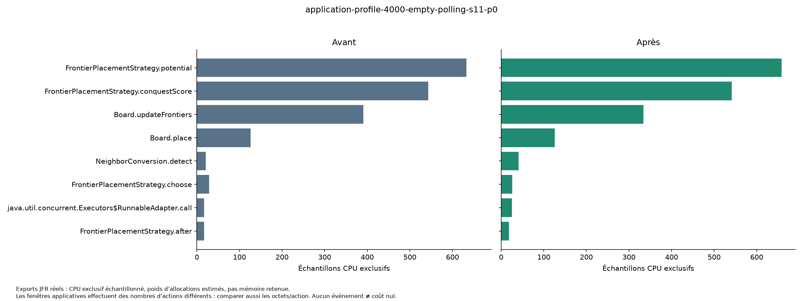

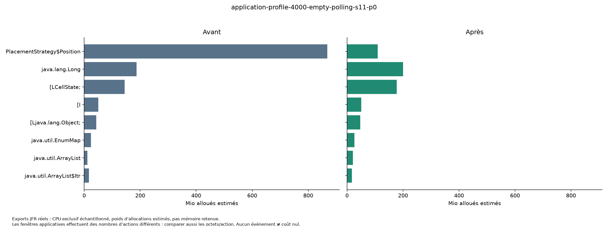

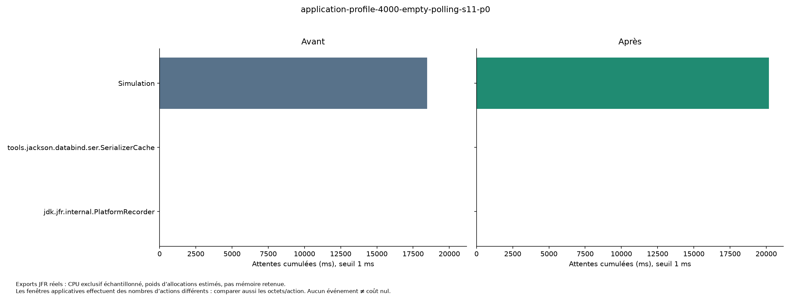

### application-profile-4000-empty-no-polling-s11-p0

| Variante | Actions | Position, octets estimés | Position, octets estimés/action | Échantillons CPU | GC / pauses (ms) |
|---|---:|---:|---:|---:|---|
| before | 660828 | 974710224 | 1 474,98 | 1869 | 25,45 / 25,45 |

before : principales méthodes exclusives : org.pixelwar.pixelwar.domain.FrontierPlacementStrategy.potential (662) ; org.pixelwar.pixelwar.domain.FrontierPlacementStrategy.choose (544) ; org.pixelwar.pixelwar.domain.Board.updateFrontiers (359) ; org.pixelwar.pixelwar.domain.Board.place (127). [Export complet](03-positions-primitives/profiles/application-profile-4000-empty-no-polling-s11-p0-before.summary.json).

Pile d’allocations Position (before) : `Board.randomFrontierPosition → FrontierPlacementStrategy.choose → Simulation.play → Simulation.playRound` ; poids 964240960 octets estimés, 1 459,14 octets estimés/action. Pile complète conservée dans l’export, sans fusion avec les allocations d’autres classes.

Pile d’allocations Position (before) : `Board.randomEmptyPosition → FrontierPlacementStrategy.choose → Simulation.play → Simulation.playRound` ; poids 10469264 octets estimés, 15,84 octets estimés/action. Pile complète conservée dans l’export, sans fusion avec les allocations d’autres classes.

| after | 676440 | 125230096 | 185,13 | 1874 | 24,14 / 24,14 |

after : principales méthodes exclusives : org.pixelwar.pixelwar.domain.FrontierPlacementStrategy.potential (645) ; org.pixelwar.pixelwar.domain.FrontierPlacementStrategy.conquestScore (523) ; org.pixelwar.pixelwar.domain.Board.updateFrontiers (352) ; org.pixelwar.pixelwar.domain.Board.place (146). [Export complet](03-positions-primitives/profiles/application-profile-4000-empty-no-polling-s11-p0-after.summary.json).

Pile d’allocations Position (after) : `FrontierPlacementStrategy.choose → Simulation.play → Simulation.playRound → Simulation.lambda$activate$0` ; poids 110025872 octets estimés, 162,65 octets estimés/action. Pile complète conservée dans l’export, sans fusion avec les allocations d’autres classes.

Pile d’allocations Position (after) : `Board.randomEmptyPosition → FrontierPlacementStrategy.choose → Simulation.play → Simulation.playRound` ; poids 15204224 octets estimés, 22,48 octets estimés/action. Pile complète conservée dans l’export, sans fusion avec les allocations d’autres classes.

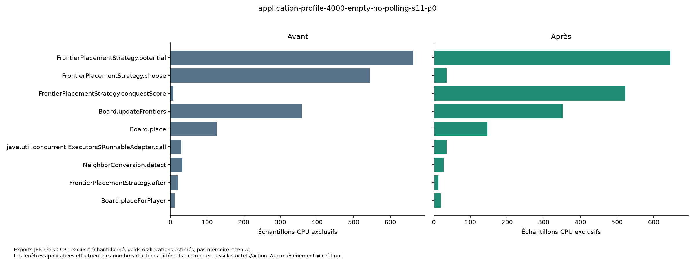

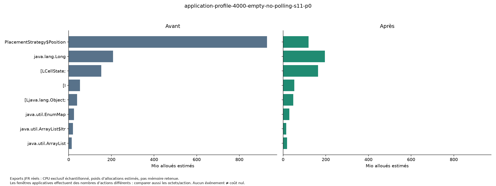

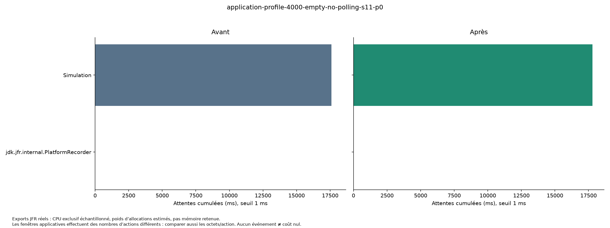

Les profils remplis moteur comparent un même nombre d’actions, tandis que les fenêtres applicatives peuvent exécuter davantage d’actions après. Une hausse d’octets par seconde ou de poids total JFR ne réfute donc pas une baisse par action. Une part CPU relative peut augmenter alors que la durée baisse ; échantillons, temps CPU exact et octets/action ne sont pas interchangeables. Aucun cache-miss matériel n’est mesuré, aucune absence de GC n’est extrapolée au serveur entier.

## 6. Décision et suite

Les allocations moyennes/action baissent de 23,18 à 47,07 % selon le scénario moteur. Les variations moyennes de débit vont de -6,63 à 1,39 %. Les ratios par paire et leur dispersion empêchent de généraliser une accélération à toutes les charges.

**Conserver le changement pour la suppression ciblée des allocations**, sous réserve des régressions de débit explicitement visibles dans les tableaux. Cette décision ne revendique pas une amélioration universelle : les différences d’inlining, la division/modulo et les coûts de scoring conservés peuvent limiter le gain. Les profils indiquent les prochains coûts à étudier (scoring/accès Board et autres allocations), sans engager une autre optimisation ici. O2 ne reçoit aucune portion du gain. Le gain marginal O3 est celui de cette expérience ; le gain cumulé face à V3 reste non mesuré faute de protocole commun repris.

L’échec initial d’un nouveau jeu de test (pose EMPTY interdite) a été corrigé en laissant la case vide à la préparation ; le journal d’échec est conservé. Il ne constitue pas un échec de performance de l’optimisation. Les régressions réellement mesurées doivent être appréciées avec la dispersion, sans en fabriquer une pour le barème.

## 7. Reproduction, remise et correspondance au barème

Le script PowerShell reconstruit des archives Git isolées, compile les deux références et le même banc Java depuis les scripts livrés. Il n’exécute pas les variantes simultanément. Les classes du banc sont comparées octet par octet ; les JAR ont leurs SHA-256 propres (horodatages ZIP possibles). Une reproduction requiert le dépôt aux commits du rapport, JDK 27, Maven/son cache, PowerShell Windows et Python avec les versions de requirements.txt. [Commande unique et phases réellement utilisées](03-positions-primitives/COMMANDES.md). Le moteur et ses tests de production sont identifiés par commit ; les scripts d’analyse/livraison sont dans l’archive et n’interviennent pas dans le gameplay.

L’archive `target/audit-opti-03.zip` contient rapport, synthèse courte, données et unités, scripts, profils originaux et exports, figures, journaux, JAR effectivement mesurés, patch et manifeste SHA-256. Une extraction indépendante vérifie les empreintes et les liens relatifs. Les JFR sont volumineux et restent hors Git ; leurs exports sont versionnés. La reproduction du code nécessite le dépôt : aucun dossier .git ni secret n’est embarqué.

| Critère | Points | Statut et pièces | Limite pour l’audit final |
|---|---:|---|---|
| Environnement et métrologie | 3 | Couvert : §1/3/4, environnement, observations, summary, paires | Fréquence/affinité/température non contrôlées ; fenêtre SMALL courte |
| Diagnostic réel | 5 | Couvert : §1/5, JFR avant/après, exports, vues CPU/allocations | Échantillonnage, seuil moniteurs, aucun compteur matériel |
| Journal d’ingénierie | 5 | Couvert : §2/3/6, code isolé, RNG et rejeux | O3 traite les allocations ; pas réseau/persistance/parallélisme |
| Échec constructif | 3 | Partiel : dispersions/régressions observées §4/6 ; incident de test conservé | Pas de variante de production rejetée artificiellement |
| Reproductibilité et synthèse | 4 | Couvert : commande, références, données, figures, archive et vérification | Prérequis Windows/Java/Python ; bruit machine possible |
| Gouvernance IA | +2 | Non traité : aucun constitution.md dédié constaté | Les quatre directives et bonus ne sont pas présumés acquis |

JFR/JMC tient le rôle de profils CPU/allocations comparable à pprof ; le pilote de JVM neuves, chauffe et statistiques tient le rôle métrologique attendu d’Hyperfine. Les différences Java/Go et l’adéquation finale au barème restent à apprécier par l’évaluateur. Aucun score n’est auto-attribué.
